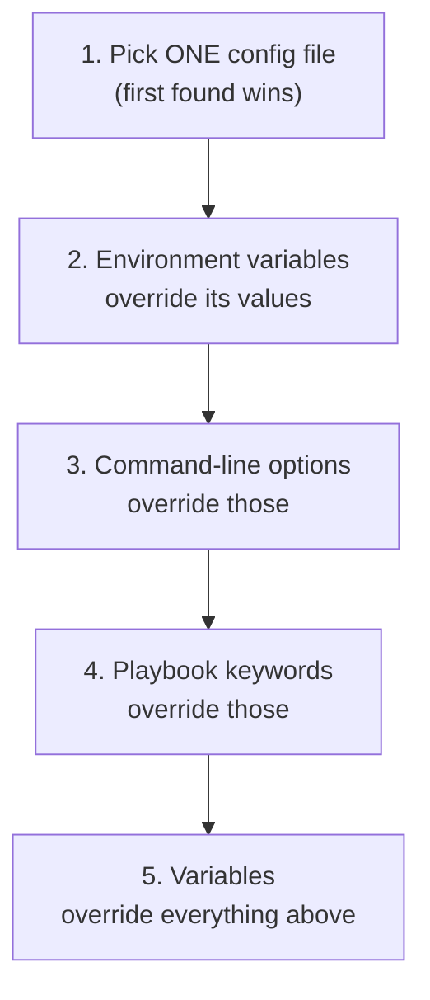

# 2 - Inventory and Configuration

## Quick Summary

Inventory tells Ansible which hosts exist and how to group/connect to them. Configuration, usually through `ansible.cfg`, controls defaults such as inventory path, remote user, roles path, host key checking, and privilege behavior.

Beginner mental model:

```text
inventory = where to run
playbook = what to run
ansible.cfg = default behavior
```

## Inventory Basics

INI inventory:

```ini
[web]
web1 ansible_host=10.0.1.10
web2 ansible_host=10.0.1.11

[db]
db1 ansible_host=10.0.2.10
```

YAML inventory:

```yaml
all:
  children:
    web:
      hosts:
        web1:
          ansible_host: 10.0.1.10
        web2:
          ansible_host: 10.0.1.11
    db:
      hosts:
        db1:
          ansible_host: 10.0.2.10
```

## Groups

Groups let you target roles of servers.

```bash
ansible web -i inventory.ini -m ping
ansible db -i inventory.ini -m ping
ansible all -i inventory.ini -m ping
```

Group examples:

- `web`
- `db`
- `cache`
- `prod`
- `staging`
- `linux`

## Inventory Variables

Host variable:

```ini
web1 ansible_host=10.0.1.10 ansible_user=ubuntu
```

Group variable:

```ini
[web:vars]
ansible_user=ubuntu
app_port=8080
```

Better for larger projects:

```text
group_vars/
  web.yml
host_vars/
  web1.yml
```

## Common Connection Variables

| Variable | Meaning |
| --- | --- |
| `ansible_host` | Real IP/DNS to connect to. |
| `ansible_user` | Remote SSH user. |
| `ansible_port` | SSH port. |
| `ansible_ssh_private_key_file` | SSH key path. |
| `ansible_connection` | Connection type, such as `ssh` or `local`. |
| `ansible_python_interpreter` | Python path on managed host. |

## ansible.cfg

Example:

```ini
[defaults]
inventory = ./inventory.ini
remote_user = ubuntu
host_key_checking = True
roles_path = ./roles

[privilege_escalation]
become = True
become_method = sudo
become_user = root
```

Find current config:

```bash
ansible-config dump --only-changed
```

## Config Precedence

"Config precedence" covers two different questions, and most confusion comes from mixing them up:

1. **Which config file does Ansible read?** Exactly one file, chosen by a search order.
2. **When the same setting is given in several ways, which value wins?** The remote user, for example, can come from `ansible.cfg`, an environment variable, `-u`, the playbook or an inventory variable.

Checked against the current ansible-core documentation on 2026-11-21.

### Why Ansible looks in more than one place

Different people need defaults at different scopes:

- An administrator wants machine-wide defaults for everyone on the control node.
- You want personal defaults, such as the SSH key you usually use.
- A project needs defaults that travel with its code in git, such as its inventory path and roles path.
- Now and then, a single run needs a different config without editing any file.

One fixed path cannot serve all four. So Ansible searches a list of locations, from the most specific to the most general.

### Which file: the first one found wins

1. `ANSIBLE_CONFIG`: the path in this environment variable, if it is set.
2. `./ansible.cfg`: in the current working directory.
3. `~/.ansible.cfg`: in your home directory. Note the leading dot: it is a hidden file.
4. `/etc/ansible/ansible.cfg`: the system-wide default, usually present when Ansible comes from an OS package.

Ansible stops at the first file it finds and ignores the others **completely**. Settings are not merged across files. If none of the four exists, Ansible uses its built-in defaults.

This is the opposite of Git, which is where many people's intuition comes from. Git reads its system, global and repository config files and layers them, so a repository's config only needs the settings it changes. Ansible does not layer. A project `ansible.cfg` that sets only `inventory` means every other setting falls back to the built-in default, not to your `~/.ansible.cfg`.

The tradeoff: once you know which file is in use, the single-file rule makes behavior easy to reason about, because that one file holds every non-default setting. The price is that the file in use depends on the directory you run from, so the same command can behave differently in two directories. That is why a project should put everything it relies on in its own `ansible.cfg`.

**Security: a world-writable current directory is skipped.** If anyone can write to the directory, anyone could plant an `ansible.cfg` there that makes your next run load and execute their code. So Ansible prints a warning and refuses to load `./ansible.cfg` from a world-writable directory. This often hits projects on Windows drives mounted in WSL (`/mnt/c/...`), which usually show as world-writable. Two fixes:

- Move the project into the Linux filesystem (for example under `~/`), where normal permissions apply.
- Or point `ANSIBLE_CONFIG` at the file's absolute path, which tells Ansible you trust that file:

  ```bash
  export ANSIBLE_CONFIG="$PWD/ansible.cfg"
  ```

  Do this only for a directory you control, because it switches the protection off for that file.

### Which value: the precedence ladder

Choosing the file is only the first step. A setting can still be given in other ways, and Ansible ranks those sources in categories, from lowest to highest:

1. **Configuration settings:** values from the chosen `ansible.cfg`, overridden by environment variables (`ANSIBLE_*`).
2. **Command-line options,** such as `-u` / `--user`. Any command-line option overrides any configuration setting.
3. **Playbook keywords,** such as `remote_user:` or `become:` on a play, block, role or task.
4. **Variables,** such as `ansible_user` from inventory, `group_vars` or `host_vars`. Extra vars passed with `-e` override all other variables.

The logic is that the value closest to the actual host and task wins. A config file is a general default for every run. A command-line option is your choice for this run. A playbook keyword is the playbook author's choice for this play or task. A variable can be set for one particular host.



Here is the remote user set in every category at once:

| Category | How the remote user is set | Example |
| --- | --- | --- |
| Config file | `remote_user` in `[defaults]` | `remote_user = ubuntu` |
| Environment variable | `ANSIBLE_REMOTE_USER` | `export ANSIBLE_REMOTE_USER=deploy` |
| Command-line option | `-u` / `--user` | `ansible-playbook -u admin site.yml` |
| Playbook keyword | `remote_user:` on the play | `remote_user: app` |
| Variable | `ansible_user` for the host | `ansible_user: web` in `host_vars/web1.yml` |

With all five set, Ansible connects to `web1` as `web`. Remove the variable and it connects as `app`. This is why `-u` sometimes seems to be ignored: something in a higher category, a playbook keyword or an inventory variable, is already set.

When two values fall in the same category:

- **Configuration settings:** the environment variable beats the file.
- **Command line:** the last value given wins. `ansible -u mike -m ping myhost -u carol` connects as `carol`.
- **Playbook keywords:** the more specific wins. A task beats its block or role, which beats the play.
- **Variables:** Ansible has a detailed variable precedence order of its own; see [Variables Facts Templates and Handlers](4%20-%20Variables%20Facts%20Templates%20and%20Handlers.md). Extra vars (`-e`) sit at the top.

The docs also list one category above variables, *direct assignment*: options passed straight to a module or lookup, such as `msg=` on `debug`. That governs module arguments rather than settings like the ones in this section.

### Seeing what Ansible actually used

Don't reason it out from memory; ask Ansible.

```bash
ansible --version
```

Read the `config file =` line. It shows the path of the file in use, or `None` if no file was found. If it shows `/etc/ansible/ansible.cfg` when you expected the project's file, then you are in the wrong directory, `ANSIBLE_CONFIG` is set somewhere, or the project directory was skipped as world-writable (look for the warning).

```bash
ansible-config dump --only-changed
```

Lists every setting that differs from the built-in default, with where its value came from: the config file or an environment variable. If a setting you wrote in `ansible.cfg` is missing here, Ansible is reading another file, or the section or key name is misspelled.

```bash
ansible-config list
```

Shows every setting with its default, its ini section and key, and its environment variable. Use it to find a setting's environment variable instead of guessing. Most are `ANSIBLE_<KEY>`, but not all: the `error` key under `[colors]` is `ANSIBLE_COLOR_ERROR`.

`ansible-config` reports configuration settings only. It knows nothing about the `-u` you pass to another command, playbook keywords or inventory variables. If a value is still surprising after `dump` looks right, check the higher categories: the command you ran, the play and task keywords, and `ansible-inventory --host <host>` for that host's variables.

### Worked example: personal settings that vanish

Your `~/.ansible.cfg`:

```ini
[defaults]
private_key_file = ~/.ssh/lab_key
```

The project's `ansible.cfg`:

```ini
[defaults]
inventory = ./inventory.ini
```

From your home directory, `ansible all -i ~/project/inventory.ini -m ping` works. Inside `~/project`, `ansible all -m ping` fails with `Permission denied (publickey)`. Predict why before opening the answer.

> [!question]- Answer
> Inside the project, Ansible reads only `./ansible.cfg`. `private_key_file` from `~/.ansible.cfg` no longer applies, so SSH never offers the lab key. (From the home directory there is no `./ansible.cfg`, so the search reached `~/.ansible.cfg`.) `ansible --version` run inside the project would show the project file in use. Fix it by adding `private_key_file` to the project's `ansible.cfg`, or by setting `ansible_ssh_private_key_file` in `group_vars` for the hosts that need that key.

### Check yourself

**1. A play sets `remote_user: app`. You run `ansible-playbook -u admin site.yml`, and the host has no `ansible_user`. Which user does Ansible connect as? How could you force `admin` for this one run without editing any file?**

> [!question]- Answer
> `app`. Playbook keywords rank above command-line options, so the play's `remote_user:` beats `-u`. To force `admin` for one run, pass it as a variable, which ranks above keywords: `ansible-playbook -e ansible_user=admin site.yml`. Extra vars are the highest-precedence variables.

**2. Last month you added `export ANSIBLE_CONFIG=/opt/team/ansible.cfg` to your `~/.bashrc` and forgot about it. Now every project's own `ansible.cfg` seems to be ignored. Why, and what is the quickest way to confirm it?**

> [!question]- Answer
> `ANSIBLE_CONFIG` is first in the search order, so when it is set, Ansible never even looks for `./ansible.cfg`. `ansible --version` would show `config file = /opt/team/ansible.cfg`. Run `unset ANSIBLE_CONFIG` for the current shell and remove the line from `~/.bashrc`.

## Testing Inventory

List hosts:

```bash
ansible-inventory -i inventory.ini --list
ansible-inventory -i inventory.ini --graph
```

Ping:

```bash
ansible all -i inventory.ini -m ping
```

## Dynamic Inventory

Dynamic inventory gets hosts from an external source such as:

- AWS EC2.
- Azure.
- GCP.
- VMware.
- Kubernetes.
- CMDB.

Use dynamic inventory when hosts change often.

## Benefits

- Clear target grouping.
- Environment-specific variables.
- Reusable defaults.
- Supports static and dynamic infrastructure.

## Drawbacks / Limitations

- Variable precedence can be confusing.
- Bad group names lead to messy playbooks.
- Inventory secrets need encryption.
- Dynamic inventory requires plugin setup and credentials.

## Hidden Details / Caveats

- Inventory host alias and `ansible_host` can differ.
- Group variables apply to all hosts in the group.
- A host can belong to multiple groups.
- Variable precedence decides final value when multiple places define the same variable.
- Host key checking protects against MITM but can surprise beginners.
- Ansible reads only one config file, the first it finds. Settings from your `~/.ansible.cfg` do not apply inside a project that has its own `ansible.cfg`.
- `ansible-config` reports configuration settings only. Command-line options, playbook keywords and variables can still override what it shows.
- `-u` loses to `remote_user:` in the play and to `ansible_user` in inventory, because both rank higher than command-line options.

## Common Mistakes

| Mistake | Fix |
| --- | --- |
| Hard-coding IPs in playbooks | Put hosts in inventory. |
| Mixing prod and dev accidentally | Separate inventories or clear groups. |
| Disabling host key checking globally | Understand risk; manage known hosts. |
| Secrets in plain group_vars | Use Vault. |
| Wrong SSH user | Set `ansible_user`. |

## Troubleshooting

| Problem | Check |
| --- | --- |
| Host unreachable | IP/DNS, SSH key, user, port, security group/firewall. |
| Wrong inventory used | `ansible-inventory --list`, working directory, config. |
| Python not found | `ansible_python_interpreter`. |
| Permission denied | SSH user, key permissions, sudo/become config. |
| Variables not expected | `ansible-inventory --host <host>` and precedence. |
| Setting in `ansible.cfg` ignored | `config file =` line of `ansible --version`, `ANSIBLE_CONFIG`, world-writable directory warning, spelling of section and key, `ansible-config dump --only-changed`. |
| `-u` seems ignored | `remote_user:` in the play or task, `ansible_user` in inventory; both outrank `-u`. |

## Interview Notes

- Inventory defines managed hosts.
- Groups let playbooks target roles/environments.
- `ansible.cfg` controls defaults.
- Ansible reads only the first config file it finds: `ANSIBLE_CONFIG`, then `./ansible.cfg`, then `~/.ansible.cfg`, then `/etc/ansible/ansible.cfg`.
- Setting precedence, lowest to highest: configuration settings (file, then environment variables), command-line options, playbook keywords, variables.
- Static inventory is file-based; dynamic inventory queries external systems.
- `group_vars` and `host_vars` store variables.

## Related Topics

- [Ansible Fundamentals](1%20-%20Ansible%20Fundamentals.md)
- [Variables Facts Templates and Handlers](4%20-%20Variables%20Facts%20Templates%20and%20Handlers.md)
- [KodeCloud Ansible Course](KodeCloud%20Ansible%20Course.md): course notes on config files and config precedence

## Official References

- [Inventory guide](https://docs.ansible.com/ansible/latest/inventory_guide/intro_inventory.html)
- [Ansible configuration settings](https://docs.ansible.com/ansible/latest/reference_appendices/config.html)
- [Configuring Ansible](https://docs.ansible.com/ansible/latest/installation_guide/intro_configuration.html)
- [Controlling how Ansible behaves: precedence rules](https://docs.ansible.com/ansible/latest/reference_appendices/general_precedence.html)
- [Ad hoc commands](https://docs.ansible.com/ansible/latest/command_guide/intro_adhoc.html)
