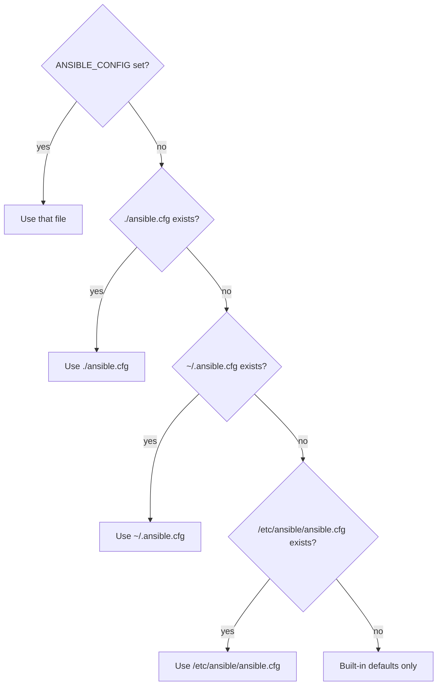

# Intro to Ansible

- **Quick to pick up:** playbooks are readable YAML, so you don't need to know a programming language to start.
- **Simple for everyone in IT,** not just developers.
- **Powerful at scale:** handles complex, multi-server deployments.

For what Ansible is and how it works underneath (control node, managed nodes, modules, idempotency), see [Ansible Fundamentals](1%20-%20Ansible%20Fundamentals.md).

# Configurations and Basic Concepts

## Ansible's default config

Location: `/etc/ansible/ansible.cfg`

This file is there when Ansible is installed from an OS package manager. A pip or source install may not have it. To generate a template that lists every setting, commented out, run:

```bash
ansible-config init --disabled > ansible.cfg
```

The config file is split into sections:

1. `[defaults]`
2. `[inventory]`
3. `[privilege_escalation]`
4. `[ssh_connection]`
5. `[colors]`

The full file has a few more, such as `[paramiko_connection]` and `[persistent_connection]`. Each section holds settings we can tune.

### Using a different config file

We are not tied to a single config file. Different projects or playbooks can use different configs, depending on what each one needs. To point Ansible at a specific file, set `ANSIBLE_CONFIG`:

```bash
# Use /opt/ansible-config.cfg instead of the default config, for this command only
ANSIBLE_CONFIG=/opt/ansible-config.cfg ansible-playbook site.yml
```

### Order of precedence for config files

Ansible checks these locations in order and uses the **first file it finds**. It ignores the rest completely: their settings are not merged in.

1. Environment variable: `ANSIBLE_CONFIG`
2. Current directory: `./ansible.cfg`
3. Home directory: `~/.ansible.cfg` (note the leading dot: it is a hidden file)
4. Default location: `/etc/ansible/ansible.cfg`

The order runs from most specific to most general. A one-off choice for this command (the environment variable) beats the project's file, which beats your personal file, which beats the system-wide default.



For the full picture, including which value wins when a setting is given in several ways, see Config Precedence in [Inventory and Configuration](2%20-%20Inventory%20and%20Configuration.md).

### Overriding a single parameter

Say the config file is fine, but we need to change just one setting. We don't have to copy or edit the whole file:

1. Find the setting's name, for example `gathering` in the `[defaults]` section.
2. Its environment variable is usually `ANSIBLE_` plus the name in uppercase: `ANSIBLE_GATHERING`.
3. Set it: `export ANSIBLE_GATHERING=explicit`

Not every setting follows that naming pattern. For example, the `error` key under `[colors]` is set by `ANSIBLE_COLOR_ERROR`, not `ANSIBLE_ERROR`. `ansible-config list` shows the exact environment variable for every setting, so look it up there instead of guessing.

A value set through an environment variable beats the same setting in any `ansible.cfg` file. It is not the top of the whole chain, though. Ansible's precedence, from lowest to highest, is: configuration settings (the file, then environment variables), then command-line options, then playbook keywords, then variables. So even with `ANSIBLE_GATHERING=explicit` exported, a play that says `gather_facts: true` still gathers facts, because a playbook keyword beats a configuration setting.

What `gathering = explicit` does: by default (`implicit`), every play gathers facts about its hosts unless the play says `gather_facts: false`. With `explicit`, plays skip fact gathering unless they ask for it. Teams use it to speed up runs that don't need facts.

There are 3 ways to pass a parameter. The difference is how long the change lasts:

1. On the command line, for this one command only:

   ```bash
   ANSIBLE_GATHERING=explicit ansible-playbook site.yml
   ```

2. Exported, for the rest of this shell session:

   ```bash
   export ANSIBLE_GATHERING=explicit
   ```

3. In an `ansible.cfg` in the current (project) directory, permanently, for anyone who runs Ansible from that directory:

   ```ini
   # ./ansible.cfg
   [defaults]
   gathering = explicit
   ```

Ways 1 and 2 are environment variables, so if both are used alongside way 3, the environment variable wins.

### Inspect current Ansible config

1. `ansible-config list`: shows every option with its default value, its description, and the ini key and environment variable that set it.
2. `ansible-config view`: shows the contents of the config file that is in use now.
3. `ansible-config dump`: shows the current value of every setting and where each value came from. Add `--only-changed` to see only the settings that differ from the defaults.

`ansible --version` also prints a `config file =` line. It is the quickest way to see which file Ansible picked up.

## Intro to YAML

Key-value pairs are written as `key: value`.

- A space is required after the colon (`:`). Without it, `key:value` is read as one plain string, not as a key with a value.

Lists use a dash:

```yaml
Fruits:
  - Orange
  - Apple
  - Banana
```

- A space is required after the dash too: `-Orange` is a string, not a list item.
- Indentation is how YAML knows the items belong to `Fruits`. Indent with spaces, never tabs: YAML does not allow tabs for indentation. Two spaces is the usual convention.

This is  a dictionary:
```yaml
Fruits:
- Banana:
	Calories: 105
	Fat: 0.4g
	Carbs: 27g
- Grape:
	Calories: 62
	Fat: 0.3g
	Carbs: 10g
```
Dictonries are unordered
ANd lists are ordered
ANy line which starts with # gets ignored, as it's counts as a comment

# Ansible Inventory
## Agentless by design
Ansible connects to Linux systems, it connects to windows pc by using powershell remoting
default inventory file: /etc/ansible/hosts
Unless we point the file else where, that's the file it reads
```ini
server1.company.com
server2.company.com

[mail]
server3.company.com
server4.company.com

[db]
server5.company.com
server6.company.com

[web]
server7.company.com
server8.comapny.com
```
A single ini file can contain multiple server's list, and multiple groups

Better way to write ini file:
- plane name tells you noting
- web a alias reads the far better
- ansible_host holds the FQDN or IP addresses
```ini
web ansible_host=server1.company.com
db ansible_host=server2.company.com
mail ansible_host=server3.company.com
web2 ansible_host=server4.company.com
```

### inventory_parameter:
ansible_connection:
This can take 3 values
1. Linux Machine: ansible_connection=ssh
2. Widnows Machine: ansible_connection=winrm
3. Your Own Machine: ansible_connection=localhost

### Port and User
1. ansible_port:
	1. Default ssh port is 22, you change the value if server listens elsewhere
2. ansible_user:
	1. the account ansible logs in with, on linux that account is root
3. ansible_password:
	1. The ssh password ansible uses for a linux host
	2. passwordless ssh key authectication is the better way
	3. production secrets are stored in ansible vaults
## Inventary Formats
We can use .ini file in case of small inventory, but for large invetories, a large YAML is preferred

```yaml
all:
	children:
		webservers:
			hosts:
				web1.example.com
				web2.example.com
		dbservers:
			hosts:
				db1.example.com
				db2.example.com
```

## Grouping an parent child relationships


# Ansible Variables
In an inventory file, ansible host, ansible connection, ansible password are all variables

you can also define there variables in playbooks itseld
```yaml
- name: Add DNS Server to resolv.conf
  hosts: localhost
  vars:
	  dns_servre: 10.1.250.10
  
  tasks:
  - ansible.builtin.lineinfile:
    path: /etc/resolv.conf
    line: "nameserver {{ dns_servers }}"
    #line: "nameserver 10.1.250.10"
```

You can also define these variables in other files
Best version is to move those varaibles in a file which contains the host variables details

## VAriable types
String vars
username: "admin"

Number
max_connections: 100
hard_limit: "{{ max_connections * 2 }}"

Booleaan variables
debug_mode: true

other accepted values: yes, on, 1

list var
packages: 
- nginx
- postgres
- git

dictionary vars
they have key value pairs

user:
- name: "admin"
- password: "secret"

msg: "{{ user }}" <- THe whole dictionary
msg: "{{ user.name }}" <- Only the name

## Registering variables and variable preference

```ini
[web_servers]
web1 ansible_host=172.20.1.100
web2 ansible_host=172.20.1.101
web3 ansible_host=172.20.1.102 dns_server=10.5.5.4

[web_servers:vars]
dns_servers=10.5.5.3
```
Here in this case, the group vars 10.5.5.3 will get applied first, then the Host's vars will land on top of the group vars

So the final dns_server will be=10.5.5.4

the host value wins that's variable precedence

we can also add a vars in playbook, and since that has been added in the play book, it will have the highest priority

play var > host var > group var

### the full precende order
2 role defaults
3 inventory file or script group vars
6 invertory group_vars
8 inventory file or script host vars
12 play vars
15 role vars (defined in role/vars/main.yml)
19 set_facts/registered vars
22 extra vars (always win precendence)

### capture output with register
```yaml
---
- name: check /etc/hosts file
  hosts: all
  tasks: 
   - shell: cat /etc/hosts
     register: result
   - debug:
	     var: result
```

Shell -> Runs the command
register -> Stores the output of the command ran by shell
debug -> shows the result on screen
var -> we are showing the var result, on screen

### whats inside result?
```json
ok: [web1] => {
	"result": {
		"changed": true,
		"cmd": "cat /etc/hsots",
		"delta":
		"end":
		"rc": 0,
		"start": ,
		"stderr": "",
		stdout: "",
		"stdout_lines": [""],
	}
}
```


## variable scope
