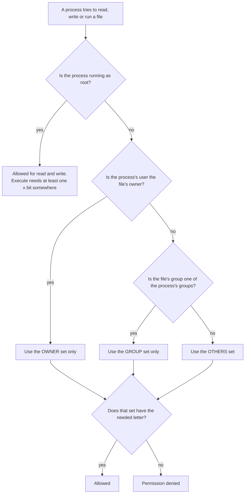

---
aliases:
  - Linux permissions
  - chmod
tags:
  - study/chapter
  - study/linux
area: shared-foundations
topic: linux
status: developing
difficulty: beginner
source: "man chmod, man chown, man umask (bash builtin), man 7 credentials, GNU coreutils documentation"
version: "Modern Linux distributions (Ubuntu 22.04/24.04, RHEL 9). The permission model itself has been stable for decades."
created: 2026-11-24
updated: 2026-11-24
---

# 1 - Users, Groups and File Permissions

> [!info] How to use this chapter
> Every part starts with an everyday picture, then gives the real Linux version, then a worked example. Every technical word is explained the first time it appears. Try each question before you open its answer.
>
> If you only have ten minutes, read **Part 3 (the first-match rule)** and **Part 4 (octal numbers)**. Those two cause most real-world permission mistakes.

## Why This Chapter Matters

"Permission denied" is one of the most common errors you will meet on a Linux server, in a Docker container, in a CI/CD pipeline and in a Kubernetes Pod. Each time, the fix is quick **if** you can read a permission string such as `-rwxr-x---` and say exactly which part applies to the user who got the error. If you can't, people guess: they run `chmod 777`, which "fixes" it by opening the file to everyone on the machine, and that becomes a security hole.

Where this shows up later:

- **SSH:** `ssh` refuses a private key whose permissions are too open (`Permissions 0644 for 'key.pem' are too open`). The fix is `chmod 600`.
- **Scripts in CI/CD:** a deploy script checked into Git without the execute bit fails with `Permission denied` in the pipeline.
- **Docker and Kubernetes:** a container running as a non-root user can't write to a mounted folder owned by root.
- **Ansible:** the `file` module's `mode`, `owner` and `group` parameters are exactly this chapter, written down.
- **systemd:** a service fails with `status=203/EXEC` when its program isn't executable (see [3 - systemd and journald](3%20-%20systemd%20and%20journald.md)).

## The Big Picture

Linux is a **multi-user** system: many people and many programs share one machine. Every file needs an answer to "who may do what with this?". Linux answers with a small, fixed scheme:

1. Every file has **one owner** (a user) and **one group**.
2. The file stores **three sets** of permissions: one for the owner, one for the group, one for everyone else.
3. Each set says yes or no to three actions: **read**, **write**, **execute**.
4. When someone touches the file, Linux picks **exactly one** of the three sets for them, and only that set decides.

That's the whole model. Everything else in this chapter is detail on top of these four lines.

## First-Principles Explanation

Why not just a list of names per file ("Priya may read, Arjun may write…")? Because in the 1970s, when Unix was designed, disk space and memory were tiny. Storing a list of names on every file was too expensive. So Unix stored just **9 bits** per file (three sets × three actions), plus one owner number and one group number. That's cheap, fast to check and good enough for most cases.

The price of that cheapness: you can't say "Priya and Arjun, but not Ravi" unless Priya and Arjun share a group that Ravi isn't in. Later, **ACLs** (access control lists, Part 9) added per-person lists on top, for the cases where the 9 bits aren't enough.

## Core Vocabulary

| Word | Plain meaning | Everyday picture |
| --- | --- | --- |
| **User** | An account on the machine. People have users, and so do services (`nginx`, `postgres`, `www-data`). Each user has a number, the **UID**. | An employee ID card |
| **root** | The superuser, UID 0. Bypasses almost every permission check. | The building's master key |
| **Group** | A named set of users, with a number, the **GID**. Used to give the same access to several people at once. | A department: everyone in "Accounts" gets into the Accounts room |
| **Primary group** | The one group a user is in by default. New files they create get this group. | Your home department |
| **Supplementary groups** | Extra groups a user also belongs to. | Committees you also sit on |
| **Owner** | The one user a file belongs to. | The person whose name is on the locker |
| **Permission bits** | The 9 yes/no switches: read, write, execute for owner, group and others. | Three price lists with three items each |
| **Mode** | The full set of permission bits, often written as a number such as `755`. | |
| **Octal** | Base-8 numbers, digits 0 to 7. One octal digit holds exactly three yes/no bits, which is why permissions are written this way. | |

## Mental Model

Think of a **club with three price lists**: members, members' family, and everyone else.

At the door, the cashier asks, **in this order**:

1. "Are you a member?" If yes, you pay the member price. **Stop.**
2. "Otherwise, are you family?" If yes, you pay the family price. **Stop.**
3. "Otherwise," you pay the everyone-else price.

The cashier never compares lists to find you the best deal. Once a question matches, that list decides, even if a later list would have been kinder to you.

Linux does exactly this with **owner → group → others**.

## Historical / Evolution / Causal Chain

**Cause:** 1970s Unix was shared by many people on one machine, with very little memory.
**Mechanism:** store 9 permission bits, one owner and one group per file; check them with a fixed first-match rule.
**Immediate result:** fast, tiny and simple to reason about, which is why it survived 50 years almost unchanged.
**Long-term impact:** the model couldn't express "these three named people", so **ACLs** were added. It couldn't let a normal user change their own password in a root-owned file, so **setuid** was added. Containers and Kubernetes still use the same UIDs, GIDs and bits, which is why `runAsUser` and `fsGroup` exist in Pod specs.
**Next connected topic:** processes run *as* a user, which is what makes the permission check happen (see [2 - Processes Ports and Signals](2%20-%20Processes%20Ports%20and%20Signals.md)).

## Architecture or Conceptual Structure



## Step-by-Step Explanation

### Part 1: Users and groups

**Picture:** an office. Each employee has an ID card (the **user**). Employees belong to departments (**groups**). Your home department is your **primary group**; committees you also sit on are **supplementary groups**.

**The real version.** Run `id` to see who you are:

```text
$ id
uid=1001(arjun) gid=1001(arjun) groups=1001(arjun),27(sudo),1005(devs)
```

Read it as:

- `uid=1001(arjun)`: my user number is 1001, name `arjun`.
- `gid=1001(arjun)`: my **primary** group is also called `arjun`. Ubuntu and RHEL create a private group with the same name for each new user.
- `groups=...`: all my groups: `arjun`, `sudo` (allowed to use `sudo`) and `devs`.

Where this is stored:

| File | What's in it | Example line |
| --- | --- | --- |
| `/etc/passwd` | One line per user: name, UID, primary GID, home folder, login shell. (Passwords are **not** in it, despite the name; they live in `/etc/shadow`, which only root can read.) | `arjun:x:1001:1001:Arjun:/home/arjun:/bin/bash` |
| `/etc/group` | One line per group, with its supplementary members | `devs:x:1005:arjun,priya` |

**Adding someone to a group:**

```bash
sudo usermod -aG devs arjun
```

- `-G devs`: set the supplementary groups to `devs`.
- `-a`: **append**, meaning add to the existing list. **Without `-a`, `-G` replaces the whole list**, and Arjun would silently lose `sudo` and every other group. This is a classic way to lock yourself out of admin rights.

> [!warning] The re-login trap
> A new group membership only applies to **new logins**. Your current shell got its group list when you logged in and doesn't refresh it. After `usermod -aG docker arjun`, Arjun still gets "permission denied" on the Docker socket until he logs out and back in (or runs `newgrp docker` in that shell). This catches almost everyone once.

**Worked example.** Priya is added to `devs` while she's logged in. She runs `id` and doesn't see `devs`. Nothing is wrong: she needs a new login. `id priya` (asking about her by name) reads the files and *will* show `devs`, which makes the confusion worse. The running shell is what counts.

### Part 2: Reading the permission string

Run `ls -l`:

```text
$ ls -l deploy.sh
-rwxr-x---  1  priya  devs  2048  Nov 24 09:10  deploy.sh
```

Split it up:

```text
-     rwx     r-x     ---      1   priya   devs   2048  date   name
type  owner   group   others   links owner group  size
```

- **First character, the type:** `-` regular file, `d` directory, `l` symbolic link (a shortcut).
- **Next nine, in three sets of three:** owner, group, others. In each set, the positions are always `r`, `w`, `x`, in that order. A `-` means "no".
- `priya` is the owner and `devs` is the group.

So for `deploy.sh`:

| Who | Set | Can |
| --- | --- | --- |
| priya (owner) | `rwx` | read, write, run |
| anyone in `devs` who isn't priya | `r-x` | read and run, not change |
| everyone else | `---` | nothing |

### Part 3: The first-match rule (the most important part)

**Linux applies exactly one set to each person: the first that matches. It never combines sets and never falls through to a later one.**

1. Are you the **owner**? Use the owner set. Stop.
2. Otherwise, is the file's group one of **your groups**? Use the group set. Stop.
3. Otherwise, use the **others** set.

**Worked example: the quirk that surprises everyone.**

```text
-rw-r--rwx  1  priya  devs  deploy.sh
```

| Person | Which question matches first | Set used | Can run it? |
| --- | --- | --- | --- |
| priya | 1: she's the owner | `rw-` | **No**, even though she owns it |
| arjun, in `devs` | 2: he's in the group | `r--` | **No** |
| ravi, a stranger | 3: neither | `rwx` | **Yes** |

The stranger can run it and the team can't. That is correct behaviour under first-match, and it's why a string like this is almost always a mistake. **Being "more trusted" does not give you more permissions; matching earlier gives you a *different* list.**

What's the use of this? You can use it on purpose to **block** one group: `-rw----r--` with group `interns` lets everyone read *except* the interns. It's rare, but it shows the rule clearly.

### Part 4: Octal numbers (755, 644 and friends)

**Picture:** each set has three switches. Give the switches values: **read = 4, write = 2, execute = 1**. Add up the switches that are on. Every combination from 0 to 7 gives a different total, so one digit describes one set exactly.

| Letters | Sum | Digit |
| --- | --- | --- |
| `---` | 0 | 0 |
| `--x` | 1 | 1 |
| `-w-` | 2 | 2 |
| `-wx` | 2+1 | 3 |
| `r--` | 4 | 4 |
| `r-x` | 4+1 | 5 |
| `rw-` | 4+2 | 6 |
| `rwx` | 4+2+1 | 7 |

Three digits: **owner, group, others**, in that order.

**Worked examples, the four you'll see daily:**

| Mode | String | Meaning | Typical use |
| --- | --- | --- | --- |
| `755` | `rwxr-xr-x` | Owner does everything; everyone else can read and run | Scripts, programs, ordinary directories |
| `644` | `rw-r--r--` | Owner reads and writes; everyone else reads | Ordinary files, configs, web pages |
| `600` | `rw-------` | Owner only | SSH private keys, files with passwords |
| `750` | `rwxr-x---` | Owner everything, group read and run, others nothing | A team's scripts or a team's folder |

**Converting by hand:** `rwxr-x---` → `rwx` = 4+2+1 = 7, `r-x` = 4+1 = 5, `---` = 0 → **750**.

### Part 5: chmod, chown and chgrp

**chmod** (change mode) changes the permission bits. Two styles:

```bash
chmod 750 deploy.sh        # numeric: set all nine bits at once
chmod u+x deploy.sh        # symbolic: add execute for the owner (u = user/owner)
chmod g-w,o-rwx notes.txt  # remove write from group (g), remove everything from others (o)
chmod a+r index.html       # add read for all (a = u, g and o together)
chmod -R g+rX shared/      # recursive; capital X = add x only to directories and to files that already have some x
```

- Numeric **replaces** all bits. Symbolic **changes only what you name**. Use symbolic when you want to touch one thing and leave the rest alone.
- `-R` means recursive (the folder and everything inside). Be careful: `chmod -R 755` makes every file executable, which is usually wrong. `chmod -R u=rwX,go=rX` is the safe pattern: files get `644`, folders get `755`.

**chown** (change owner) and **chgrp** (change group):

```bash
sudo chown priya deploy.sh          # new owner
sudo chown priya:devs deploy.sh     # new owner and group in one go
sudo chgrp devs deploy.sh           # new group only
sudo chown -R www-data:www-data /var/www/site
```

Only root can give a file to another user (otherwise you could dump files onto someone and blame them or use up their disk quota). A normal user can change a file's group, but only to a group they're in.

### Part 6: Files versus directories: same letters, different meaning

**Picture:** a directory is a **room with a list of names on the door**. The files are the things in the room.

| Letter | On a file | On a directory |
| --- | --- | --- |
| `r` | Read the contents | **List** the names inside (`ls`) |
| `w` | Change the contents | **Add, delete or rename** entries in the room |
| `x` | Run it as a program | **Enter** the room (`cd`) and reach things inside by name |

Three consequences that surprise people:

1. **Deleting a file needs `w` and `x` on the directory, not on the file.** Deleting removes a name from the room's list, so the room's permissions decide. You can delete a read-only file in your own folder (`rm` asks first, but it works). You *can't* delete a `777` file in a folder where you lack `w`.
2. **`x` on a directory is needed to get *through* it.** To read `/home/priya/project/app.conf`, you need `x` on `/home`, `/home/priya` and `/home/priya/project`, plus `r` on the file. One missing `x` anywhere on the path gives "Permission denied", and the error doesn't say which folder caused it. `namei -l /home/priya/project/app.conf` shows the permissions of every step of the path.
3. **`r` without `x` on a directory** lets you see the names but not open anything. `x` without `r` lets you open a file whose name you already know, but not list the room.

**Worked example.** nginx (running as user `www-data`) returns 403 Forbidden for `/home/priya/site/index.html`, even though `index.html` is `644`. The file is fine; `/home/priya` is `750`, and `www-data` isn't priya and isn't in her group, so it gets `---` on her home folder and can't pass through. Fix: serve from `/var/www`, or give `www-data` a way through. Don't `chmod 777` the home folder.

### Part 7: Scripts need r and x, programs need only x

- A **compiled program** (such as `/usr/bin/ls`) is loaded by the kernel directly. The kernel only checks `x`.
- A **script** (`deploy.sh`) isn't run by the kernel. The kernel reads the first line, `#!/bin/bash` (the "shebang"), and starts `/bin/bash`, which then has to **read** the file, as you. So you need `r` too. With `--x`, a script fails with `Permission denied` from bash.
- `bash deploy.sh` (passing the script to bash yourself) needs only `r`, because you're running bash, not the script. That's why "it works with `bash deploy.sh` but not with `./deploy.sh`" means the `x` bit is missing.

**What's the use of this?** In CI/CD, a script committed from Windows often has no execute bit. Fix it in Git once with `git update-index --chmod=+x deploy.sh`, so every checkout gets it, instead of adding `chmod +x` to every pipeline.

### Part 8: root, umask, and the special bits

**root bypasses read and write checks.** A process running as root can read or write any file regardless of its bits. For **execute** on a regular file, root still needs at least one `x` bit set somewhere (owner, group or others); root can't run a file that no one could run. Also, permissions don't stop root, but other mechanisms can (read-only mounts, `chattr +i`, SELinux, AppArmor).

**umask: the default for new files.** When a program creates a file, it asks for a starting mode (usually `666` for files and `777` for directories), and the **umask** removes bits from that. The umask lists the bits to take *away*.

```text
umask 022 (a common default):
  new file:       666 minus 022 → 644   rw-r--r--
  new directory:  777 minus 022 → 755   rwxr-xr-x

umask 077 (private):
  new file:       666 minus 077 → 600
  new directory:  777 minus 077 → 700
```

("Minus" here really means "switch these bits off", not arithmetic subtraction, but with these common values the result is the same.) Run `umask` to see yours. New files never get `x` by default, which is why every new script needs `chmod +x`. *Default umask varies by distribution and login setup (often `022`, sometimes `002` for users with a private group); verify against current docs for your distribution.*

**The three special bits** add a fourth octal digit in front (`4755`, `2775`, `1777`):

| Bit | Value | On a file | On a directory | You'll see it as |
| --- | --- | --- | --- | --- |
| **setuid** | 4 | The program runs **as the file's owner**, not as you | (no common effect on Linux) | `s` in the owner's `x` spot: `-rwsr-xr-x` |
| **setgid** | 2 | The program runs with the file's group | **New files inside get the directory's group** instead of the creator's primary group | `s` in the group's `x` spot: `drwxrwsr-x` |
| **sticky** | 1 | (no effect on Linux) | Only a file's owner (or the directory's owner, or root) may delete or rename it | `t` in the others' `x` spot: `drwxrwxrwt` |

Real examples:

- **setuid:** `/usr/bin/passwd` is `-rwsr-xr-x root`. You run it as yourself, but it runs as root, so it can update `/etc/shadow` (which you can't touch). This is powerful and dangerous: a bug in a setuid-root program is a route to root. Linux ignores setuid on scripts, for that reason.
- **setgid on a directory:** a shared team folder `/srv/devs` with mode `2775` and group `devs`. Every new file gets group `devs`, so the team can always share them.
- **sticky:** `/tmp` is `1777` (`drwxrwxrwt`). Everyone can create files there, but nobody can delete anyone else's.

A capital `S` or `T` means the special bit is set but the `x` under it isn't, which is usually a mistake.

### Part 9: ACLs, when 9 bits aren't enough

ACLs (access control lists) let you add named people or groups to one file: "and also user `ravi` may read". 

```bash
setfacl -m u:ravi:r report.txt   # give ravi read access
getfacl report.txt               # show the full list
```

A file with an ACL shows a `+` at the end of `ls -l`: `-rw-r-----+`. **When you see `+`, the 9 bits aren't the full story; run `getfacl`.** (With ACLs, the group set shown by `ls -l` becomes the ACL "mask", which caps what named users and groups can get. Verify against `man acl` if you rely on this.)

## Internal Mechanics

- A file's owner, group and mode live in its **inode**, the file's record on disk. The **name** lives in the directory. This is why deleting is about the directory (removing a name) and not about the file.
- The check uses the **process's** UID and group list, not "the person". When nginx reads a file, the check is for user `www-data`, whoever started nginx.
- The group list is copied into a process when it starts and inherited by its children. That's the mechanical reason a new group needs a new login.
- Permissions are checked when a file is **opened**. A program that already has a file open keeps its access even if you `chmod` the file afterwards.

## Practical Examples

**Lock down an SSH key:**

```bash
chmod 600 ~/.ssh/id_ed25519
chmod 700 ~/.ssh
```

`ssh` refuses keys that the group or others can read, because a key anyone can read isn't secret.

**A shared team folder:**

```bash
sudo mkdir /srv/devs
sudo chgrp devs /srv/devs
sudo chmod 2770 /srv/devs   # setgid + rwx for owner and group, nothing for others
```

**Find files that anyone can write to (a security audit):**

```bash
find /var/www -type f -perm -o+w
```

`-perm -o+w` matches files where "others" has write permission.

## Small Details That Matter Later

- **Exactly one set applies.** Owner, then group, then others; first match wins. A group member gets the group set even when "others" is more generous.
- **`usermod -G` without `-a` replaces all groups.** Always `-aG`.
- **New group membership needs a new login.** `id` in the old shell won't show it.
- **Delete permission comes from the directory**, not the file.
- **Every directory on the path needs `x`.** `namei -l <path>` finds the one that's missing.
- **Scripts need `r` and `x`; programs need only `x`.** "Works with `bash script.sh`, fails with `./script.sh`" means the `x` bit is missing.
- **New files never get `x` by default** because of the `666` starting point.
- **`chmod -R 755` makes every file executable.** Use `u=rwX,go=rX`.
- **A `+` at the end of `ls -l`** means an ACL is present; `getfacl` shows the real picture.
- **root bypasses read and write checks** but still needs at least one `x` bit to run a file, and can still be stopped by read-only mounts or SELinux.
- **`ssh` rejects private keys that are too open.** The error tells you the mode; the fix is `chmod 600`.
- **Containers use the same numbers.** A container running as UID 1000 writing to a volume owned by UID 0 gets "Permission denied" even if the names differ inside and outside. The *numbers* are what's compared. Kubernetes `securityContext.fsGroup` exists for exactly this.
- **Files committed from Windows lose the `x` bit.** Fix it in Git with `git update-index --chmod=+x`.

## Common Misunderstandings

| Belief | Reality |
| --- | --- |
| "Others has `x`, so anyone can run it." | Only people who match neither owner nor group. Owner and group members use their own sets. |
| "The owner can always do anything." | The owner gets exactly the owner set. `---------` locks the owner out too (though the owner can `chmod` it back). |
| "I can't delete a read-only file." | You can, if you have `w` and `x` on the directory. |
| "`chmod 777` fixes permission problems." | It hides them, and lets every user and every compromised service on the machine change the file. |
| "`r` on a directory lets me open files in it." | That needs `x`. `r` only lists names. |
| "I added myself to the group, so it works now." | Only after a new login. |

## Failure Modes / Mistakes / Traps

| Symptom | Likely cause | Check |
| --- | --- | --- |
| `./deploy.sh: Permission denied` | No `x` for the set that applies to you | `ls -l deploy.sh`, then `id` to see which set is yours |
| Works with `bash deploy.sh` only | Missing `x` | `chmod u+x deploy.sh` |
| nginx 403 on a file that is `644` | A directory on the path lacks `x` for `www-data` | `namei -l /full/path` |
| `Permissions 0644 for 'key.pem' are too open` | SSH key readable by others | `chmod 600 key.pem` |
| Lost `sudo` after a group change | `usermod -G` without `-a` | `id`; fix as root from another session |
| Docker: `permission denied ... docker.sock` right after joining `docker` group | Old login session | Log out and in, then `id` |
| Container can't write to a mounted folder | UID inside the container doesn't match the folder's owner | `ls -ln` (numbers, not names) on the host |

## Debugging / Analysis / Answer-Writing Method

For any "Permission denied":

1. **Who is asking?** Find the user the **process** runs as: `id` for your shell, `ps -o user= -p <PID>` for a service.
2. **Which object?** The file, and **every directory on its path**: `namei -l /path/to/file`.
3. **Which set applies?** Owner? Group (is the file's group in `id`'s list)? Otherwise others. Pick exactly one.
4. **Which letter is needed?** Read (`r`), change (`w`), run (`x` on a file), pass through (`x` on a directory), delete (`w`+`x` on the directory).
5. **Anything extra?** A `+` (ACL), a read-only mount, SELinux denials (`ausearch -m avc` on RHEL-family systems; verify against current docs).
6. **Fix narrowly:** add one letter for one set, or fix ownership. Never `777`.

## Real-World or Exam Relevance

- **Interviews:** "What does `chmod 750` mean?", "Why can't a group member run a file whose others bits are `rwx`?", "What does the sticky bit on `/tmp` do?"
- **CKA and CKAD:** `securityContext` fields (`runAsUser`, `runAsGroup`, `fsGroup`), volume permission errors, and file modes on ConfigMap and Secret volumes (`defaultMode`, written in octal).
- **AWS:** SSH key files for EC2 (`chmod 400` or `600`), and EFS mounts shared by several instances with different UIDs.
- **Production:** most "it works for me but not for the service" bugs are a process running as a different user than the one who tested.

## Connected Topics

- [2 - Processes Ports and Signals](2%20-%20Processes%20Ports%20and%20Signals.md): every process runs as a user, which is what the permission check compares.
- [3 - systemd and journald](3%20-%20systemd%20and%20journald.md): `User=` in a unit file sets which user a service runs as; `203/EXEC` often means a missing `x`.
- [Bash](Bash.md): scripts, the shebang line and exit codes.
- [Ansible: Playbooks, Tasks and Modules](../../devops-cloud/ansible/3%20-%20Playbooks%20Tasks%20and%20Modules.md): the `file`, `user` and `group` modules are `chmod`, `chown`, `useradd` and `groupadd` written as desired state. Write `mode: "0750"` as a quoted string so YAML doesn't read it as a decimal number.

## Chapter Summary

- Every file has one owner, one group and three sets of `rwx`: owner, group, others.
- Linux picks **exactly one set** per person, the first that matches: owner, then group, then others.
- Octal: read 4, write 2, execute 1, added up per set. `755`, `644`, `600` and `750` cover most cases.
- On directories, `r` lists, `w` adds and deletes names, and `x` lets you enter and pass through. Deleting a file is a directory permission.
- Scripts need `r` and `x`; new files never get `x` by default (umask).
- setuid runs a program as its owner, setgid on a directory shares a group, and sticky on `/tmp` stops people deleting each other's files.

## Questions to Test Understanding

**1. (Mechanism)** A file is `-rwx---r-x  root  ops`. Meena isn't root and is in `ops`. Can she read the file? Can she run it?

> [!question]- Answer
> Neither. She isn't the owner, but she **is** in `ops`, so the group set applies: `---`. The others set (`r-x`) would have let her read and run it, but it's never checked for her, because the group question matched first.

**2. (Calculation)** Convert `rw-r-----` to octal, and say who can do what.

> [!question]- Answer
> `rw-` = 4+2 = 6, `r--` = 4, `---` = 0, so **640**. The owner reads and writes, the group reads, everyone else gets nothing. This is a common mode for a config file containing a password that one service group needs to read.

**3. (Trap)** `secret.txt` is `-r--------` and owned by you. It sits in your home directory, which is `drwx------` and also yours. Can you delete it? Why?

> [!question]- Answer
> Yes. Deleting removes a name from the **directory**, so it needs `w` and `x` on the directory, which you have. The file's own bits don't matter for deletion. `rm` will ask "remove write-protected file?" as a courtesy, but it will succeed.

**4. (Purpose)** Why does `/tmp` have the sticky bit? What would go wrong without it?

> [!question]- Answer
> `/tmp` must be writable by everyone (`777`) so every user and program can create temporary files. But `w` on a directory also allows deleting any name in it. Without the sticky bit, any user could delete or replace other users' temporary files, which breaks their programs and opens attacks (for example, swapping a file that a root process is about to read). The sticky bit keeps "everyone may create" but limits deleting and renaming to the file's owner.

**5. (Failure mode)** A CI job runs `./scripts/build.sh` and fails with `Permission denied`. Locally on your Windows laptop, running it through Git Bash with `bash scripts/build.sh` works. What's the likely cause, and the lasting fix?

> [!question]- Answer
> The file has no execute bit in Git. `bash scripts/build.sh` only needs read permission, because bash is the program being run; `./scripts/build.sh` needs `x`. Windows doesn't track the execute bit, so the file was committed without it. Fix it once in the repository with `git update-index --chmod=+x scripts/build.sh` and commit, so every checkout gets the bit.

**6. (Connection)** A Kubernetes Pod runs as UID 1000 and mounts a volume whose files are owned by UID 0 with mode `644`. The app can read the files but can't write to them. Why, and which Pod setting is designed for this?

> [!question]- Answer
> UID 1000 isn't the owner (UID 0), and unless it shares the file's group, it gets the others set, `r--`: read but not write. The comparison is by **number**, so names inside the container don't matter. `securityContext.fsGroup` makes Kubernetes set the volume's group to a chosen GID and add that GID to the container's processes, so the group set applies (for volume types that support it; verify against current Kubernetes docs).

## Answers and Reasoning

The answers are in the collapsed callouts under each question, so you have to try first. The reasoning pattern behind all of them is the same four steps: **who is the process, which object (including each directory), which one set applies, which letter is needed.**
