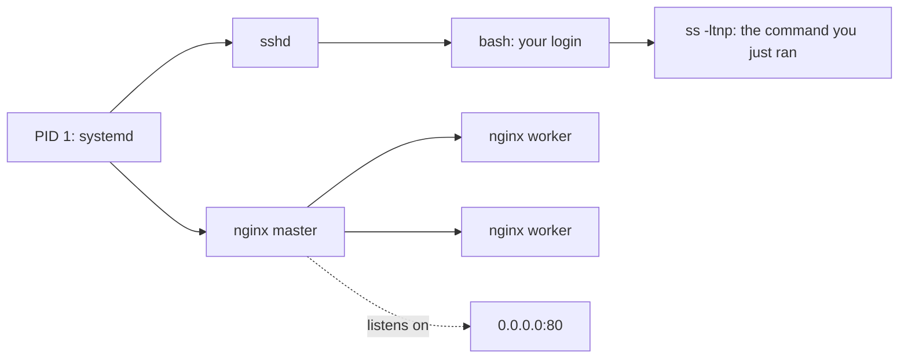

---
aliases:
  - Linux processes
  - Linux signals
  - ss command
tags:
  - study/chapter
  - study/linux
area: shared-foundations
topic: linux
status: developing
difficulty: beginner
source: "man ps, man ss, man lsof, man kill, man 7 signal, man 2 bind, man 7 capabilities"
version: "Modern Linux distributions (Ubuntu 22.04/24.04, RHEL 9) with iproute2's ss and procps-ng's ps."
created: 2026-11-24
updated: 2026-11-24
---

# 2 - Processes, Ports and Signals

> [!info] How to use this chapter
> Every part starts with an everyday picture, then gives the real Linux version, then a worked example. Every technical word is explained the first time it appears. Try each question before you open its answer.
>
> If you only have ten minutes, read **Part 4 (finding who holds a port)** and **Part 6 (SIGTERM before SIGKILL)**.

## Why This Chapter Matters

Three situations you will hit again and again:

1. **"Address already in use."** Your app won't start because something else is on its port. You need to find *what*, in one command.
2. **"Connection refused."** The network path is fine, but is anything actually listening, and on which address? (This links straight to [0 - Networking in Plain Language](../networking/0%20-%20Networking%20in%20Plain%20Language.md), Part 3.)
3. **"Just kill it."** Stopping a process the wrong way (`kill -9` first) can corrupt files and lose data. Stopping it the right way is what Kubernetes, Docker and systemd all do for you, and you need to know it to debug slow or messy shutdowns.

## The Big Picture

- A **program** is a file on disk. A **process** is that program **running**, with its own memory, its own user, and a number (the **PID**).
- A process that wants network traffic asks the operating system for a **port** and **listens** on it.
- You control processes by sending them **signals**: small numbered messages such as "please stop" (SIGTERM) or "stop now, no discussion" (SIGKILL).

## First-Principles Explanation

Why does a machine need numbered processes, ports and signals at all?

- Many programs run at once on one machine. The kernel (the core of the operating system) has to keep them apart and track each one, so it gives each a **PID**.
- Network packets arrive at one IP address. The kernel has to know **which program** each packet is for, so programs claim **ports**, and only one program can claim a given address and port at a time.
- The kernel, and you, need a way to tell a running program "something happened" without the program having to check constantly. **Signals** are that interrupt: a tap on the shoulder.

## Core Vocabulary

| Word | Plain meaning | Everyday picture |
| --- | --- | --- |
| **Process** | A running copy of a program | A cook actually cooking, as opposed to the recipe (the program) |
| **PID** | Process ID, the number the kernel gives each process | A token number at a bank counter |
| **Parent / child** | The process that started another one, and the one it started | A manager and the worker they hired |
| **Port** | A number 0 to 65535 that says which program on a machine should get a packet | The flat number inside a building |
| **Socket** | The kernel's object for one end of a network conversation | The phone handset |
| **Listening socket** | A socket that waits for new connections on a port | Someone sitting by the phone, waiting for it to ring |
| **Bind** | Claiming an address and port for a socket | Putting your name on flat 3000's doorbell |
| **Signal** | A small numbered message the kernel delivers to a process | A tap on the shoulder |
| **Handler** | Code in a program that runs when a particular signal arrives | The cook's plan for "the kitchen is closing" |

## Mental Model

Picture a **restaurant kitchen**:

- **Recipes** in a book are programs. A **cook** following one is a process, wearing a **token number** (PID).
- Each cook stands at a numbered **counter window** (port) where orders come in. Two cooks can't share one window.
- The manager can tell a cook **"finish the dish you're on, clean your station, then go home"** (SIGTERM), or have security **carry them out mid-dish** (SIGKILL). The first leaves the kitchen clean; the second leaves half-cooked food and a mess.

## Historical / Evolution / Causal Chain

**Cause:** many programs share one machine and one IP address.
**Mechanism:** PIDs keep processes apart; ports split one IP address between many programs; signals give the kernel and admins a way to interrupt processes.
**Immediate result:** you can find, inspect and stop any process, and every network service has a findable port.
**Long-term impact:** the same mechanics run inside every container. `docker stop`, `systemctl stop` and Kubernetes Pod termination are all "send SIGTERM, wait, then send SIGKILL".
**Next connected topic:** systemd, the program that starts and stops services for you (see [3 - systemd and journald](3%20-%20systemd%20and%20journald.md)).

## Architecture or Conceptual Structure



Every process has one parent. Following parents upwards always ends at **PID 1**, the first process the kernel starts (systemd on modern distros).

## Step-by-Step Explanation

### Part 1: Processes and PIDs

**Picture:** the recipe book versus the cook. `/usr/sbin/nginx` is the recipe. When you start it, the kernel creates a cook (a process), gives it a token (PID), and records **which user** it runs as. That user is what the permission checks in [1 - Users Groups and File Permissions](1%20-%20Users%20Groups%20and%20File%20Permissions.md) compare against.

**See all processes:**

```text
$ ps aux
USER       PID %CPU %MEM    VSZ   RSS TTY   STAT START   TIME COMMAND
root         1  0.0  0.3 167000 12000 ?     Ss   09:00   0:02 /sbin/init
root       812  0.0  0.1  55000  4000 ?     Ss   09:00   0:00 nginx: master process /usr/sbin/nginx
www-data   813  0.0  0.2  55800  7000 ?     S    09:00   0:00 nginx: worker process
arjun     4521  1.2  1.5 980000 60000 pts/0 Sl+  10:15   0:03 node server.js
```

Columns that matter most:

| Column | Meaning |
| --- | --- |
| `USER` | Which user the process runs as. Note nginx: the master runs as root (to claim port 80), the workers as `www-data` (safer). |
| `PID` | Its number. You need this to send it signals. |
| `%CPU`, `%MEM` | Share of CPU and memory right now |
| `RSS` | Memory actually in use, in kilobytes |
| `STAT` | State: `R` running, `S` sleeping (waiting for something, which is normal), `D` stuck waiting on disk or network storage (can't be interrupted), `Z` zombie (Part 7), `T` stopped |
| `COMMAND` | What was run |

(`aux` is old BSD-style syntax with no dash: `a` all users' processes, `u` user-oriented columns, `x` include processes not attached to a terminal.)

**Useful variations:**

```bash
ps aux | grep '[n]ginx'     # find nginx; the [n] trick stops grep from matching its own line
pgrep -a nginx              # PIDs and command lines of processes named nginx
ps -ef --forest             # show parent → child as a tree (PPID column = parent PID)
top                         # live view; press P to sort by CPU, M by memory, q to quit
```

**What `ps` can't tell you:** which **port** a process is using. That's a different table in the kernel, and you need `ss` or `lsof` for it (Part 4). This is the mistake from the placement quiz.

### Part 2: Ports and listening

**Picture:** a building (the machine, one IP address) with 65,536 flats (ports). A program that wants visitors puts its name on a flat's doorbell (**binds**) and waits by the door (**listens**). The kernel delivers each arriving connection to whoever is listening on the flat number written on it.

Two rules:

1. **One listener per address and port.** If nginx is on port 80, a second program asking for port 80 gets `EADDRINUSE: address already in use`. (Exceptions exist, such as `SO_REUSEPORT`, but they need both programs to opt in.)
2. **Ports below 1024 are "privileged".** A normal user can't bind to them; you need root or the `CAP_NET_BIND_SERVICE` capability. This is why nginx's master starts as root and why apps often listen on 3000 or 8080 instead. (The cut-off is a kernel setting, `net.ipv4.ip_unprivileged_port_start`, and some setups change it; verify on your system.)

### Part 3: Which address? 127.0.0.1 versus 0.0.0.0

A program binds to an **address and** a port. Which address matters a lot:

| Bound to | Who can connect | Picture |
| --- | --- | --- |
| `127.0.0.1:5432` (loopback) | Only programs **on the same machine** | A doorbell inside the flat, reachable only by people already in the building |
| `10.0.6.17:5432` (one specific address) | Anyone who reaches that address | A doorbell on one particular entrance |
| `0.0.0.0:5432` (all IPv4 addresses) | Anyone who reaches **any** of the machine's addresses | A doorbell on every entrance |
| `[::]:5432` or `*:5432` | All IPv6 addresses (and often IPv4 too); `*` means all addresses | Every entrance, including new ones |

**Worked example: the "connection refused" mystery.** You start a dev server on an EC2 instance and `curl localhost:3000` works on the server. From your laptop, `curl http://<server-ip>:3000` gives **connection refused**, and the security group allows 3000. Why? The server is bound to `127.0.0.1:3000`. Your packet reached the machine (so no timeout), but nothing listens on **the public-facing address** at port 3000, so the kernel answers "refused". Fix: make the app bind to `0.0.0.0` (often a `--host 0.0.0.0` option or a `HOST` setting). The same thing happens inside Docker containers, where `127.0.0.1` means "inside this container only".

### Part 4: Finding which process holds a port

**`ss`** (socket statistics) lists the kernel's socket table:

```text
$ sudo ss -ltnp
State   Recv-Q  Send-Q  Local Address:Port   Peer Address:Port  Process
LISTEN  0       128           0.0.0.0:22          0.0.0.0:*      users:(("sshd",pid=702,fd=3))
LISTEN  0       511           0.0.0.0:80          0.0.0.0:*      users:(("nginx",pid=812,fd=6),("nginx",pid=813,fd=6))
LISTEN  0       244         127.0.0.1:5432        0.0.0.0:*      users:(("postgres",pid=990,fd=7))
LISTEN  0       511                 *:3000              *:*      users:(("node",pid=4521,fd=19))
```

Every flag:

| Flag | Meaning | Without it |
| --- | --- | --- |
| `-l` | **L**istening sockets only | You also get every established connection, which is noisy |
| `-t` | **T**CP only | (Use `-u` for UDP, such as DNS on 53) |
| `-n` | **N**umeric: show `22`, not `ssh` | Port names are looked up, which is slower and hides the actual number |
| `-p` | **P**rocess: show which program owns each socket | **No process column**, so you can't answer "who holds this port?" |

Reading it:

- `Local Address:Port` is the address and port the program is **bound to** (Part 3). postgres here accepts only local connections.
- `Peer Address:Port` is `*` for listeners, because they aren't talking to anyone yet.
- `users:(("node",pid=4521,fd=19))`: program name, PID, and the internal file-descriptor number. nginx shows two PIDs because the master and a worker share the socket.

> [!warning] Use sudo with `-p`
> Without `sudo`, `ss -p` only shows the process for **your own** sockets. For a service running as another user, the Process column is simply blank, with no error. A blank column usually means "run it again with sudo", not "no process".

**Filter for one port:**

```bash
sudo ss -ltnp 'sport = :3000'    # ss's own filter: source (local) port 3000
sudo ss -ltnp | grep ':3000'     # simpler, and works fine
```

**`lsof`** (list open files) is the alternative. On Linux, sockets are "open files" too:

```text
$ sudo lsof -i :3000
COMMAND  PID  USER   FD   TYPE  DEVICE SIZE/OFF NODE NAME
node    4521 arjun   19u  IPv6  51234      0t0  TCP *:3000 (LISTEN)
```

`lsof` isn't always installed on minimal servers or container images; `ss` (part of `iproute2`) nearly always is.

**Worked example.** `npm start` fails with `Error: listen EADDRINUSE: address already in use :::3000`. (`:::3000` means "all IPv6 addresses, port 3000".) Run `sudo ss -ltnp | grep ':3000'`, which shows `node` with `pid=4521`. Run `ps -o user,lstart,cmd -p 4521` to see who started it and when; it's yesterday's dev server, still running in another terminal. Stop it properly (Part 6).

### Part 5: Signals

**Picture:** a tap on the shoulder with a number on it. Most taps mean "please do X", and the program can decide how to react (it has a **handler**). Two taps can't be refused.

| Signal | Number | Sent by | Default effect | Can the program catch it? |
| --- | --- | --- | --- | --- |
| **SIGHUP** | 1 | `kill -HUP`; originally "terminal hung up" | Terminate. By convention, many daemons (nginx, sshd) use it to **reload config** instead. | Yes |
| **SIGINT** | 2 | Pressing **Ctrl+C** | Terminate | Yes |
| **SIGKILL** | 9 | `kill -9` | **Killed immediately by the kernel** | **No**, never |
| **SIGTERM** | 15 | `kill` with no number (the default) | Terminate | Yes, so the program can clean up |
| **SIGSTOP** | (varies by CPU type) | `kill -STOP` | Pause | **No** |

(Numbers 1, 2, 9 and 15 are the same on all common Linux platforms; `kill -l` lists them all on your machine.)

**Sending signals:**

```bash
kill 4521            # SIGTERM (the default): "please shut down"
kill -TERM 4521      # same thing, written explicitly
kill -HUP 812        # ask nginx's master to reload its config
kill -9 4521         # SIGKILL: last resort
pkill -f 'node server.js'   # signal by matching the command line instead of a PID (check with pgrep -af first!)
```

You can signal your own processes; signalling another user's needs root.

### Part 6: Why SIGTERM comes before SIGKILL

**SIGTERM is a request.** The program's handler can:

- stop accepting new requests,
- finish the ones in progress,
- write buffered data to disk and close database connections cleanly,
- delete its lock file or PID file,
- then exit.

**SIGKILL is not a request.** The kernel removes the process instantly. The program runs **no code at all**: no saving, no closing, no cleanup. Results can include half-written files, a database transaction left for recovery, a stale lock file that stops the next start ("already running"), and users seeing errors mid-request.

**The standard pattern**, used by every orchestrator:

```text
send SIGTERM  →  wait a grace period  →  still alive?  →  send SIGKILL
```

| System | Grace period (default) |
| --- | --- |
| `docker stop` | 10 seconds |
| Kubernetes Pod deletion | 30 seconds (`terminationGracePeriodSeconds`) |
| `systemctl stop` | 90 seconds (`TimeoutStopSec`, default from `DefaultTimeoutStopSec`) |

*Verify these defaults against current docs; they're configurable and can change between versions.*

So `kill -9` is for a process that has **ignored** SIGTERM for a reasonable time, or is genuinely hung. If you find yourself needing `-9` every time, the program's shutdown handling is broken, and that's the bug to fix.

**What's the use of this?** "Our Pods take exactly 30 seconds to stop" is a classic Kubernetes puzzle. The answer is almost always that the app ignores SIGTERM, so Kubernetes waits the full grace period and then sends SIGKILL. Part 7 has the most common reason.

### Part 7: Parents, children, zombies and orphans

When a process finishes, it leaves a small record (its exit code) for its **parent** to collect. Until the parent collects it, the dead process stays in the table as a **zombie** (`Z` in `ps`, often shown as `<defunct>`).

- **Zombie:** finished, but the parent hasn't collected its exit code. It uses no CPU or memory, only a slot in the process table. **You can't kill a zombie; it's already dead.** Fix or restart the **parent**. A few zombies are harmless; thousands mean a buggy parent and can eventually exhaust PIDs.
- **Orphan:** a process whose parent died first. It is **adopted** by PID 1 (or by a designated "subreaper"), which collects its exit code when it ends. Orphans are normal and harmless.

**The container twist (a small detail that matters later):** inside a container, your app is often **PID 1**. The kernel treats PID 1 specially: signals for which PID 1 has **no handler** are ignored, rather than killing it. So an app that never set up a SIGTERM handler ignores `docker stop` and Kubernetes termination, waits out the whole grace period, and gets SIGKILLed. Fixes: handle SIGTERM in the app, use the exec form of `CMD`/`ENTRYPOINT` so your app (not a shell) receives the signal, or run a tiny init such as `tini` (or `docker run --init`). PID 1 is also responsible for collecting orphaned zombies, which apps not written as an init don't do.

## Internal Mechanics

- The kernel keeps a process table entry for each PID, holding its user and groups, parent PID, state, open files, and signal handlers. Tools like `ps` read this from `/proc/<PID>/`, a virtual folder the kernel creates per process. `cat /proc/4521/status` shows the raw fields.
- A listening socket is an open file descriptor in the process (`fd=19` in `ss` output; `ls -l /proc/4521/fd` shows it). That's why `lsof` ("list open files") can find sockets.
- When a process dies, the kernel closes all its sockets, freeing its ports, which is why killing the old process frees the port. (A port can stay briefly in `TIME_WAIT` after connections close, but that doesn't stop a new *listener* if the program sets `SO_REUSEADDR`, which most servers do.)
- Signal delivery: the kernel marks the signal as pending; the next time the process runs, its handler executes (or the default action happens). SIGKILL and SIGSTOP never reach a handler; the kernel acts directly.

## Practical Examples

**"Address already in use", end to end:**

```bash
sudo ss -ltnp | grep ':8080'          # who has it? → pid=2210
ps -o user,lstart,cmd -p 2210         # what is it, who started it, when?
kill 2210                             # polite stop
sleep 5; ps -p 2210 || echo "stopped" # check
# only if it's still alive after a reasonable wait:
kill -9 2210
```

If `ss` shows the port belongs to a **systemd service**, stop it with `sudo systemctl stop <name>` instead. Otherwise systemd may restart it seconds later (see [3 - systemd and journald](3%20-%20systemd%20and%20journald.md)).

**Reload nginx without dropping connections:**

```bash
sudo nginx -t                # test the config first
sudo systemctl reload nginx  # systemd sends the reload signal for you (SIGHUP for nginx)
```

## Small Details That Matter Later

- **`ps` doesn't show ports.** Use `ss -ltnp` or `lsof -i :PORT`.
- **`ss -p` needs `sudo`** to show other users' processes; without it the Process column is silently blank.
- **`-n` matters:** without it, `ss` shows `http` instead of `80`, and `grep ':80'` misses it.
- **`127.0.0.1` binding** = reachable only from the same machine (or container). From elsewhere you get **connection refused**, not a timeout.
- **`:::3000` in an error** means "all IPv6 addresses, port 3000"; it isn't a typo.
- **Ports below 1024 need root** or `CAP_NET_BIND_SERVICE`.
- **`kill` with no number sends SIGTERM (15)**, not SIGKILL.
- **SIGKILL and SIGSTOP can't be caught**, so no cleanup is possible.
- **Zombies can't be killed**; fix the parent.
- **PID 1 in a container ignores signals it has no handler for**, which causes the "always takes 30 seconds to stop" pattern.
- **Shell-form `CMD` in a Dockerfile** (`CMD node server.js`) makes `/bin/sh` PID 1, and the shell may not pass SIGTERM on to your app. Exec form (`CMD ["node", "server.js"]`) avoids that.
- **Stopping a systemd-managed process with `kill`** may just trigger a restart (always with `Restart=always`, and with `Restart=on-failure` after `kill -9`). Use `systemctl stop`.
- **`pkill -f` matches the whole command line** and can hit more than you meant (including other users' processes when run as root). Preview with `pgrep -af` first.

## Common Misunderstandings

| Belief | Reality |
| --- | --- |
| "`ps` shows which port a process uses." | It doesn't. Ports are in the socket table: `ss -ltnp`. |
| "`kill` kills immediately." | Plain `kill` sends SIGTERM, a request. Only `kill -9` is immediate. |
| "`kill -9` is the reliable way to stop things." | It's the *uncontrolled* way. It skips cleanup and can corrupt data. |
| "The app is running, so it must be reachable." | Only if it's bound to an address you can reach. `127.0.0.1` isn't reachable from outside. |
| "A zombie is a stuck process; kill it." | It's already dead. Its parent hasn't collected its exit code. |
| "Ctrl+C is the same as `kill -9`." | Ctrl+C sends SIGINT, which the program can catch and handle. |

## Failure Modes / Mistakes / Traps

| Symptom | Likely cause | Check |
| --- | --- | --- |
| `EADDRINUSE` / "address already in use" | Another process (often an old copy) holds the port | `sudo ss -ltnp \| grep ':PORT'` |
| Process column blank in `ss -p` | Not root; the process belongs to another user | Re-run with `sudo` |
| "Connection refused" from outside, works on the server | App bound to `127.0.0.1` | `ss -ltn`: look at the Local Address |
| `bind: permission denied` on port 80 | Not root and no `CAP_NET_BIND_SERVICE` | Use a port ≥ 1024 behind a proxy, or grant the capability |
| Process comes back seconds after `kill` | systemd (or a supervisor) restarts it | `systemctl status <PID>` shows which unit owns it |
| Container always takes the full grace period to stop | App is PID 1 with no SIGTERM handler, or shell-form CMD | Check the Dockerfile CMD; add a handler or `--init` |
| Hundreds of `<defunct>` processes | Parent never collects children | Find the parent with `ps -o ppid= -p <zombie PID>` |

## Debugging / Analysis / Answer-Writing Method

For "my service isn't reachable" or "my service won't start":

1. **Is the process running?** `pgrep -a <name>` or `systemctl status <name>`.
2. **Is it listening, and on what?** `sudo ss -ltnp | grep ':PORT'`. Note the bound address.
3. **Is the bound address reachable from where you're testing?** `127.0.0.1` is local only.
4. **Then go to the network:** a refusal means you reached the host and nothing listens there; a timeout means something on the path dropped it (security group, NACL, host firewall).

For "it won't stop":

1. Plain `kill` (SIGTERM), then wait.
2. Still there? Check whether it's systemd-managed and use `systemctl stop`.
3. Check its state in `ps`: `D` means it's stuck on I/O (often network storage), and even SIGKILL waits for that to finish; `Z` means it's already dead (fix the parent).
4. Only then `kill -9`.

## Real-World or Exam Relevance

- **Interviews:** "How do you find which process is using port 8080?", "Difference between SIGTERM and SIGKILL?", "What is a zombie process?"
- **CKA and CKAD:** Pod termination (SIGTERM, grace period, SIGKILL), `preStop` hooks, `terminationGracePeriodSeconds`, containers that won't stop, and `kubectl port-forward` failing because a local port is in use.
- **AWS:** apps on EC2 that work with `curl localhost` but not from the load balancer (bound to `127.0.0.1`), and health checks failing on the wrong port.
- **Docker:** `docker stop` taking 10 seconds every time; `-p 8080:80` failing because 8080 is taken on the host.

## Connected Topics

- [0 - Networking in Plain Language](../networking/0%20-%20Networking%20in%20Plain%20Language.md), Part 3: what "refused" and "timed out" prove.
- [1 - Fundamentals of Networking](../networking/1%20-%20Fundamentals%20of%20Networking.md): ports, TCP and the troubleshooting flow.
- [1 - Users Groups and File Permissions](1%20-%20Users%20Groups%20and%20File%20Permissions.md): every process runs as a user.
- [3 - systemd and journald](3%20-%20systemd%20and%20journald.md): systemd starts, stops and restarts processes, using the same signals.
- [Bash](Bash.md): exit codes, which are what a parent collects from a finished child.

## Chapter Summary

- A process is a running program with a PID, a user and a parent; `ps aux` and `top` show them.
- Programs listen on an address **and** a port; one listener per pair, and ports below 1024 need root.
- `127.0.0.1` means local only. Binding there causes "connection refused" from outside.
- `sudo ss -ltnp` shows who holds which port (`lsof -i :PORT` is the alternative); `ps` can't.
- SIGTERM (15, plain `kill`) asks politely and lets the program clean up; SIGKILL (9) can't be caught and skips cleanup. Always TERM, wait, then KILL; Docker, Kubernetes and systemd all do the same.
- Zombies are dead and need their parent fixed; orphans are adopted by PID 1. In containers, PID 1 ignores signals it doesn't handle.

## Questions to Test Understanding

**1. (Mechanism)** You run `ss -ltn | grep 5432` and see `LISTEN ... 127.0.0.1:5432`. Another server in the same VPC tries to connect to this machine's private IP on port 5432. What error does it get, and why? (The security group allows it.)

> [!question]- Answer
> **Connection refused.** The packet reaches the machine (the security group allows it, so nothing drops it on the way), but no socket is listening on the machine's private address at port 5432. Postgres is bound only to the loopback address. The kernel answers with a TCP reset ("nothing here"), which the client reports as refused. Fix: configure Postgres to listen on the private address (`listen_addresses`) and allow the client in its access rules.

**2. (Trap)** You run `ss -ltnp | grep ':443'` without sudo. You see a LISTEN line for `0.0.0.0:443`, but the Process column is empty. A colleague says "nothing owns that port". What's actually going on?

> [!question]- Answer
> Something does own it; the line wouldn't exist otherwise. Without root, `ss -p` can only show processes that belong to **you**. The listener (probably nginx running as root or `www-data`) is another user's, so the column is blank with no error. Re-run with `sudo`.

**3. (Purpose)** Why does Kubernetes send SIGTERM and wait 30 seconds before sending SIGKILL, instead of just sending SIGKILL?

> [!question]- Answer
> SIGTERM can be caught, so the app gets a chance to stop accepting new requests, finish in-flight ones, flush data and close connections. SIGKILL can't be caught, so the app would vanish mid-request, possibly leaving half-written data and failed user requests. The grace period gives a well-behaved app time to finish; SIGKILL is the backstop for apps that don't.

**4. (Failure mode)** Every time you delete a Pod, it takes exactly 30 seconds to go away. The app works fine otherwise. What's the most likely cause, and two possible fixes?

> [!question]- Answer
> The app never exits on SIGTERM, so Kubernetes waits the full 30-second grace period and then SIGKILLs it. The most common reason: the app is PID 1 in the container, has no SIGTERM handler, and PID 1 ignores signals it doesn't handle; or a shell-form `CMD` makes `/bin/sh` PID 1 and it doesn't pass the signal on. Fixes: add a SIGTERM handler to the app; use the exec form of `CMD`/`ENTRYPOINT`; or run a small init such as `tini` as PID 1.

**5. (Connection)** You `kill` a process holding port 8080. Ten seconds later, `ss` shows port 8080 in use again, by a new PID with the same program. What's restarting it, and what should you have done?

> [!question]- Answer
> A supervisor, most likely **systemd** with `Restart=` set in the unit (or Docker with a restart policy). It saw the process exit and started a new one. Find the owning unit with `systemctl status <PID>`, then use `sudo systemctl stop <unit>` (and `disable` if it shouldn't start at boot either).

**6. (Trap)** `ps` shows a process in state `Z` that refuses to go away even after `kill -9`. Why, and what do you do?

> [!question]- Answer
> It's a zombie: it has already exited, and only its exit-code record remains, waiting for the parent to collect it. There's nothing to kill. Find the parent (`ps -o ppid= -p <PID>`) and fix or restart it. When the parent exits, PID 1 adopts the zombie and cleans it up.

## Answers and Reasoning

The answers are in the collapsed callouts under each question, so you have to try first. The reasoning pattern: **is it running → is it listening, on which address → can the tester reach that address → how do I stop it without losing data.**
