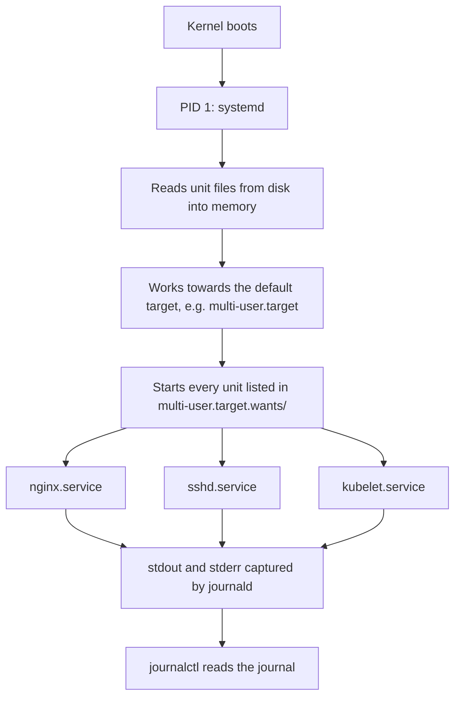
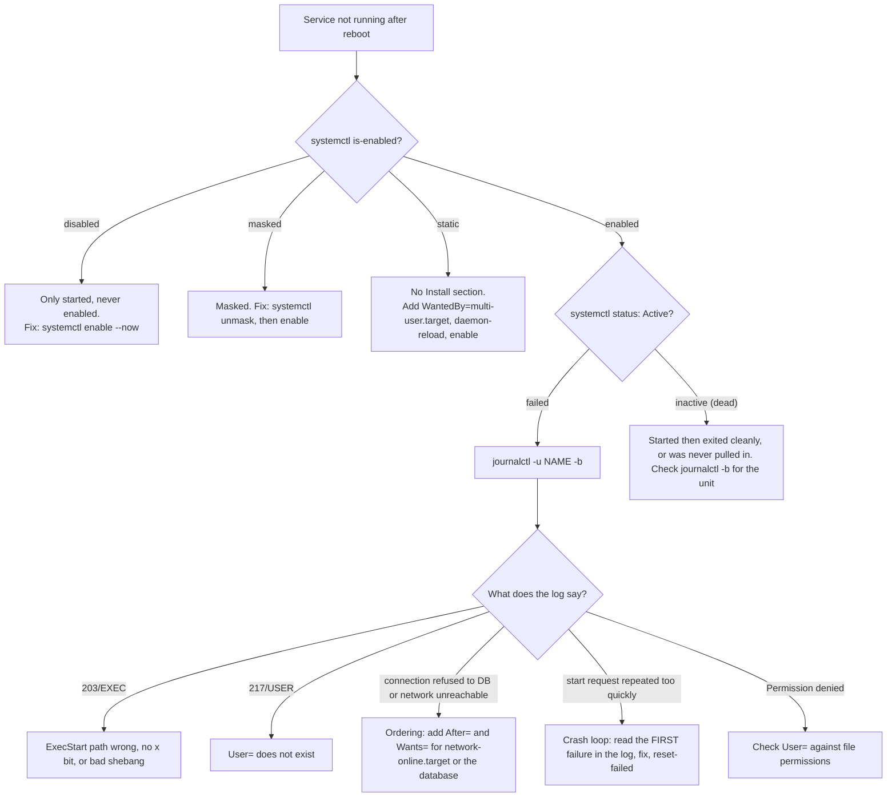

---
aliases:
  - systemd
  - systemctl
  - journalctl
tags:
  - study/chapter
  - study/linux
area: shared-foundations
topic: linux
status: developing
difficulty: beginner
source: "man systemctl, man systemd.unit, man systemd.service, man journalctl, man journald.conf (freedesktop.org systemd documentation)"
version: "systemd as shipped with Ubuntu 22.04/24.04 (systemd 249/255) and RHEL 9 (systemd 252). Output formats differ slightly between versions."
created: 2026-11-24
updated: 2026-11-24
---

# 3 - systemd and journald

> [!info] How to use this chapter
> Every part starts with an everyday picture, then gives the real Linux version, then a worked example. Every technical word is explained the first time it appears. Try each question before you open its answer.
>
> If you only have ten minutes, read **Part 3 (start versus enable)**, **Part 4 (daemon-reload)** and **Part 7 (journalctl)**.

## Why This Chapter Matters

On almost every modern Linux server, **systemd** decides which programs run, starts them at boot, restarts them when they crash, and collects their logs. When a service "works when I start it, but not after a reboot", or "doesn't pick up my config change", or "keeps restarting", the answer is in how systemd works.

It matters far beyond plain servers:

- **Kubernetes:** the **kubelet**, the agent on every node, is a systemd service. Half of CKA node troubleshooting is `systemctl status kubelet` and `journalctl -u kubelet`.
- **Docker:** the Docker daemon is `docker.service`.
- **Ansible:** the `systemd` module (`state: started`, `enabled: true`, `daemon_reload: true`) is this chapter written down.
- **AWS EC2:** the SSM agent and CloudWatch agent run as systemd services.

## The Big Picture

- When Linux boots, the kernel starts **one** program, **PID 1**. On modern distros that's **systemd**. It starts everything else.
- systemd manages **units**. A **service unit** (`nginx.service`) describes one program: how to start it, as which user, what it depends on, and whether to restart it.
- `systemctl` is the command you use to talk to systemd: start, stop, enable, check status.
- **journald** is systemd's log collector. It captures everything services print, and `journalctl` reads it.

## First-Principles Explanation

What problem does an init system solve? Without one, someone would have to:

- start every service by hand after each boot, in the right order (the database before the app that needs it, the network before both),
- notice when one crashes and start it again,
- stop them all cleanly at shutdown,
- collect what each one prints, somewhere you can find it later.

Older systems (SysV init) did this with a folder of shell scripts run one after another. Each script reinvented "start, stop, am I already running?", startup was slow because everything ran in sequence, and nothing watched services after they started. systemd replaced the scripts with short **declarative** files ("this is what I want", not "here's how to do it"), starts things in parallel when their dependencies allow, tracks every process a service creates, restarts on failure, and captures logs centrally.

## Core Vocabulary

| Word | Plain meaning | Everyday picture |
| --- | --- | --- |
| **init system / PID 1** | The first process; starts and supervises everything else | The building manager who opens up in the morning |
| **Daemon** | A program that runs in the background with no terminal, such as `nginx` or `sshd` | Staff working behind the scenes |
| **Unit** | Anything systemd manages, described by a file. Types include `.service`, `.timer`, `.socket`, `.target`, `.mount`. | One entry in the manager's handbook |
| **Unit file** | The text file describing a unit | The handbook page |
| **Service** | A unit that runs a program | A staff member's job description |
| **Target** | A named group of units, used as a stage of boot, such as `multi-user.target` (normal server, no desktop) | "Morning opening checklist" |
| **Enable** | Make a unit start automatically at boot | Add it to the opening checklist |
| **Start** | Run it right now | Ask the staff member to start working now |
| **journal** | systemd's central log store, read with `journalctl` | The building's logbook |

## Mental Model

systemd is a **building manager with a handbook and a morning checklist**:

- The **handbook** (unit files) describes every staff member: what they do, who they report after, whether to call them back if they leave.
- The **morning checklist** (a target's `.wants` folder) lists who to call in at opening (boot).
- **`start`** = "call this person in now". **`enable`** = "add them to the morning checklist". These are separate: you can call someone in today without putting them on the checklist, which is exactly why a service you only `start`ed is gone after a reboot.
- The manager **reads the handbook once** and works from memory. Editing the handbook does nothing until you say "re-read the handbook" (`daemon-reload`).
- Every staff member's chatter goes into one **logbook** (journald).

## Historical / Evolution / Causal Chain

**Cause:** SysV init scripts were slow (sequential), inconsistent (every script hand-written) and didn't supervise anything after starting it.
**Mechanism:** systemd (first released in 2010, default on major distros by about 2015) introduced declarative unit files, dependency-based parallel startup, process tracking with cgroups, automatic restarts and a central journal.
**Immediate result:** faster boots, one consistent command (`systemctl`) for every service, and logs for every service in one place.
**Long-term impact:** systemd became the standard on Ubuntu, Debian, RHEL, Amazon Linux and others. Tools such as Ansible, kubeadm and cloud agents assume it. It was also controversial for doing many jobs in one project.
**Next connected topic:** in Kubernetes, the kubelet (a systemd service) does a similar job for containers on each node: it compares what should run with what is running, and fixes the difference.

## Architecture or Conceptual Structure



## Step-by-Step Explanation

### Part 1: What a unit file looks like

Here is a complete, realistic service unit, `/etc/systemd/system/myapp.service`:

```ini
[Unit]
Description=My Node.js app
After=network-online.target postgresql.service
Wants=network-online.target

[Service]
User=myapp
WorkingDirectory=/opt/myapp
ExecStart=/usr/bin/node /opt/myapp/server.js
Restart=on-failure
RestartSec=5
Environment=PORT=3000

[Install]
WantedBy=multi-user.target
```

Three sections, three jobs:

| Section | Answers | Key lines |
| --- | --- | --- |
| `[Unit]` | What is this, and how does it relate to other units? | `Description=`; `After=` (start me **after** these, order only); `Wants=` / `Requires=` (also start these, a real dependency) |
| `[Service]` | How do I run it? | `ExecStart=` (the command, with a **full path**), `User=` (run as this user, see [1 - Users Groups and File Permissions](1%20-%20Users%20Groups%20and%20File%20Permissions.md)), `Restart=`, `Environment=` |
| `[Install]` | What happens when someone runs `enable`? | `WantedBy=multi-user.target`: "add me to the normal-boot checklist" |

**`After=` versus `Wants=`:** `After=postgresql.service` only means "if both are starting, start me second". It does **not** start Postgres. `Wants=` or `Requires=` pulls the other unit in. You often need both kinds of line. Confusing them is a classic "works on my machine, fails at boot" cause.

**Where unit files live** (in order of priority, highest first):

| Path | Who puts files there |
| --- | --- |
| `/etc/systemd/system/` | **You**, the admin. Your files and overrides go here and win over the others. |
| `/run/systemd/system/` | Created at runtime; gone after a reboot |
| `/usr/lib/systemd/system/` (RHEL) or `/lib/systemd/system/` (Debian and Ubuntu) | **Packages.** `apt` or `dnf` install files here and may overwrite them on upgrade, so don't edit them. |

*On newer distributions with a "merged /usr", `/lib` is a link to `/usr/lib`, so both paths may work; verify against current docs for your distribution.* `systemctl cat myapp` shows which file is actually in use, wherever it lives.

### Part 2: start, stop, restart, reload

These act **now** and don't survive a reboot:

| Command | What it does |
| --- | --- |
| `sudo systemctl start myapp` | Run it now |
| `sudo systemctl stop myapp` | Stop it now: SIGTERM, wait (default up to 90 s), then SIGKILL (see [2 - Processes Ports and Signals](2%20-%20Processes%20Ports%20and%20Signals.md), Part 6) |
| `sudo systemctl restart myapp` | Stop, then start. Drops connections briefly. |
| `sudo systemctl reload myapp` | Ask the running program to re-read **its own** config without stopping (runs the unit's `ExecReload=`, often a SIGHUP). Only works if the service supports it. |
| `sudo systemctl reload-or-restart myapp` | Reload if supported, otherwise restart |

Note that `reload` (the service re-reads its config) and `daemon-reload` (systemd re-reads unit files, Part 4) are completely different.

### Part 3: enable and disable (surviving a reboot)

**`start` is "now". `enable` is "at every boot".** They're independent, so a service can be:

| | Enabled | Not enabled |
| --- | --- | --- |
| **Running** | Normal production state | Running now; **gone after the next reboot** |
| **Not running** | Will start at next boot, isn't running now | Off |

**What `enable` actually changes on disk:** it reads `WantedBy=multi-user.target` in `[Install]` and creates a **symlink** (a shortcut file):

```text
$ sudo systemctl enable myapp
Created symlink /etc/systemd/system/multi-user.target.wants/myapp.service → /etc/systemd/system/myapp.service.
```

At boot, systemd heads for `multi-user.target` and starts everything in its `.wants/` folder. `disable` deletes the symlink. So "enabled" isn't a hidden setting; it's a file you can see with `ls /etc/systemd/system/multi-user.target.wants/`.

Useful shortcuts and checks:

```bash
sudo systemctl enable --now myapp   # enable AND start, in one command
sudo systemctl disable --now myapp  # disable AND stop
systemctl is-enabled myapp          # prints: enabled / disabled / static / masked
systemctl is-active myapp           # prints: active / inactive / failed
```

`static` means the unit has no `[Install]` section, so it can't be enabled itself; another unit pulls it in. `masked` means it has been linked to `/dev/null` with `systemctl mask` so nothing can start it, even by hand; `unmask` undoes that.

**Worked example.** You `start` myapp, test it, and go home. A kernel patch reboots the server overnight. Next morning myapp is down and `systemctl is-enabled myapp` says `disabled`. Fix: `sudo systemctl enable --now myapp`. Test after the next reboot too, or simulate it with `systemctl is-enabled`.

### Part 4: daemon-reload after editing a unit file

**Picture:** the manager read the handbook at opening and works from memory. You correct a page. The manager keeps following the old version until told "re-read the handbook".

systemd parses unit files into memory. When you edit one, **nothing changes until you run:**

```bash
sudo systemctl daemon-reload    # re-read all unit files from disk
sudo systemctl restart myapp    # now restart with the new settings
```

If you forget, `restart` uses the **old** settings and your change seems to do nothing. systemd usually warns you, in a line like:

```text
Warning: The unit file, source configuration file or drop-ins of myapp.service changed on disk. Run 'systemctl daemon-reload' to reload units.
```

(The exact wording varies by version.) `systemctl status` shows the same warning. Read it; it's the whole diagnosis.

`daemon-reload` doesn't restart any services by itself, so it's safe to run at any time.

**The better way to change a packaged unit: drop-ins.** Don't edit files under `/usr/lib/systemd/system/`, because a package upgrade will overwrite them. Instead:

```bash
sudo systemctl edit nginx
```

This opens an editor for `/etc/systemd/system/nginx.service.d/override.conf`, a **drop-in**: a small file whose settings are layered on top of the original. Put in only what you're changing:

```ini
[Service]
Restart=always
```

`systemctl edit` runs `daemon-reload` for you when you save. `systemctl cat nginx` then shows the original file followed by your drop-in. (`systemctl edit --full nginx` copies the whole file into `/etc/systemd/system/` instead.)

### Part 5: Reading `systemctl status`

```text
$ systemctl status myapp
● myapp.service - My Node.js app
     Loaded: loaded (/etc/systemd/system/myapp.service; enabled; preset: enabled)
     Active: active (running) since Tue 2026-11-24 09:12:03 IST; 2h 5min ago
   Main PID: 4521 (node)
      Tasks: 11 (limit: 4558)
     Memory: 48.2M
        CPU: 3.512s
     CGroup: /system.slice/myapp.service
             └─4521 /usr/bin/node /opt/myapp/server.js

Nov 24 09:12:03 web1 systemd[1]: Started myapp.service - My Node.js app.
Nov 24 09:12:04 web1 node[4521]: Listening on port 3000
```

Line by line:

| Line | Tells you |
| --- | --- |
| `●` | Colour coded: green = running, white = inactive, red = failed |
| `Loaded:` | Which file it came from, and **enabled or disabled** (the boot question). `preset:` is the distro's default suggestion; older versions print `vendor preset:`. |
| `Active:` | **Running now?** `active (running)`, `inactive (dead)`, `failed`, or `activating (auto-restart)` (crashed and waiting to restart). Plus since when. |
| `Main PID:` | The main process's PID, which ties up with `ps` and `ss -p` |
| `CGroup:` | **Every** process the service started. systemd tracks them all, so `stop` gets them all. |
| Last lines | The most recent journal lines for this unit, often the error itself |

**A failed service:**

```text
     Active: failed (Result: exit-code) since Tue 2026-11-24 09:14:10 IST; 3s ago
    Process: 4600 ExecStart=/opt/myapp/start.sh (code=exited, status=203/EXEC)
```

`status=203/EXEC` means systemd **couldn't run** the `ExecStart` program at all: the file doesn't exist, isn't executable (no `x`), or has a bad shebang line. Other common codes: `217/USER` (the `User=` doesn't exist), `200/CHDIR` (the `WorkingDirectory=` doesn't exist or isn't reachable). A plain number like `status=1/FAILURE` means the program started and exited with that code, so look in its logs. *systemd's special exit codes are listed in `man systemd.exec`; verify against current docs.*

To see everything that failed: `systemctl --failed`.

### Part 6: Restart on failure (and its limit)

```ini
[Service]
Restart=on-failure
RestartSec=5
```

- `Restart=on-failure`: restart if the program exits with a non-zero code, is killed by an unexpected signal (such as SIGKILL or SIGSEGV), or times out. A clean exit isn't restarted, and **systemd counts death by SIGTERM, SIGINT, SIGHUP or SIGPIPE as clean**, so a plain `kill` doesn't trigger it.
- `Restart=always`: restart after any exit, clean or not, including a plain `kill`. Only `systemctl stop` stops it for good.
- `RestartSec=5`: wait 5 seconds before restarting, so a crash loop doesn't hammer the machine.

**The rate limit:** if a unit starts too many times too quickly, systemd gives up and marks it failed with `start request repeated too quickly`. The defaults are `StartLimitBurst=5` starts within `StartLimitIntervalSec=10s` (*verify against current docs*). When you see that message, the real error is in the logs of the **first** failures; reset the counter with `sudo systemctl reset-failed myapp` after fixing it.

**What's the use of this?** A service that crashes once at 3 a.m. comes back by itself. But `Restart=` also hides problems: a service can crash every few minutes for weeks while looking "active". Check `NRestarts` with `systemctl show myapp -p NRestarts`.

### Part 7: journald and journalctl

**Picture:** one logbook for the whole building. Every service's output (anything it prints to stdout or stderr) goes into it, labelled with the unit name, the time and the priority.

```bash
journalctl -u myapp                  # all logs for one unit (oldest first)
journalctl -u myapp -f               # follow: show new lines as they arrive (like tail -f)
journalctl -u myapp -n 50            # last 50 lines
journalctl -u myapp -e               # jump to the end in the pager
journalctl -u myapp --since "1 hour ago"
journalctl -u myapp --since today
journalctl -u myapp --since "2026-11-24 09:00" --until "2026-11-24 09:30"
journalctl -b                        # everything since the current boot
journalctl -b -1                     # everything from the PREVIOUS boot
journalctl --list-boots              # which boots the journal holds
journalctl -p err -b                 # only priority "err" and worse, this boot
journalctl -u myapp --no-pager       # print straight out, for piping into grep
```

Flag meanings:

| Flag | Meaning |
| --- | --- |
| `-u UNIT` | Only this unit. Repeat to combine: `-u nginx -u myapp`. |
| `-f` | Follow live |
| `-n N` | Last N lines |
| `-b` | Since this boot; `-b -1` the previous boot, `-b -2` the one before |
| `--since`, `--until` | Time window; accepts `"YYYY-MM-DD HH:MM"`, `today`, `yesterday`, `"1 hour ago"` |
| `-p PRIORITY` | This priority **and more severe**: `emerg`, `alert`, `crit`, `err`, `warning`, `notice`, `info`, `debug` |

**`-b -1` is the reboot detective.** "The server rebooted at 2 a.m., why?" → `journalctl -b -1 -e` shows the last lines before the reboot.

> [!warning] The journal may not survive a reboot
> journald's `Storage=` setting (in `/etc/systemd/journald.conf`) defaults to `auto`: logs are kept on disk **only if `/var/log/journal/` exists**; otherwise they live in memory (`/run/log/journal/`) and **vanish at reboot**. Then `journalctl -b -1` says there's no previous boot. Some distributions create `/var/log/journal/` by default and some don't, so **check yours**: `journalctl --list-boots` showing only one boot after several reboots means it isn't persistent. To make it persistent: `sudo mkdir -p /var/log/journal` then `sudo systemctl restart systemd-journald` (or set `Storage=persistent`). *Distribution defaults vary; verify against current docs.*

Permissions: a normal user sees only their own logs. To read system logs, use `sudo` or be in the `systemd-journal` group (also `adm` on Ubuntu, `wheel` on some others; verify for your distribution).

## Internal Mechanics

- **Enable is just a symlink.** `systemctl enable` reads `[Install]` (`WantedBy=`) and creates links in `<target>.wants/`. Nothing else changes.
- **systemd keeps parsed unit files in memory**, which is why edits need `daemon-reload`.
- **cgroups:** systemd puts each service's processes in a kernel **control group** (`/system.slice/myapp.service`). That's how it tracks every child process (a forking program can't escape), stops them all, and applies limits such as `MemoryMax=`. Docker and Kubernetes use the same kernel feature for container limits.
- **Logs:** systemd connects each service's stdout and stderr to journald, which stores structured, indexed entries (unit, PID, priority, boot ID), which is why filtering by unit or boot is instant.

## Practical Examples

**A full "new service" workflow:**

```bash
sudo nano /etc/systemd/system/myapp.service   # write the unit
sudo systemctl daemon-reload                  # systemd reads it
sudo systemctl enable --now myapp             # start now, and at every boot
systemctl status myapp                        # check Active: and Loaded: ... enabled
journalctl -u myapp -f                        # watch it run
```

**Change a setting later:**

```bash
sudo systemctl edit myapp       # drop-in; daemon-reload is automatic
sudo systemctl restart myapp
systemctl cat myapp             # confirm what's in effect
```

### Troubleshooting: "my service doesn't start at boot"



## Small Details That Matter Later

- **`start` ≠ `enable`.** Start is now; enable is every boot. `enable --now` does both.
- **`enable` creates a symlink** in `/etc/systemd/system/<target>.wants/`, based on `WantedBy=`. No `[Install]` section means `static`, which can't be enabled.
- **Edited a unit? `daemon-reload`**, then restart. `systemctl edit` does the reload for you.
- **`reload` ≠ `daemon-reload`.** One asks the service to re-read its config; the other makes systemd re-read unit files.
- **Don't edit files under `/usr/lib/systemd/system/` or `/lib/systemd/system/`;** package upgrades overwrite them. Use `systemctl edit` drop-ins.
- **`After=` only orders; it doesn't pull anything in.** Pair it with `Wants=` or `Requires=`.
- **`network.target` doesn't mean "the network is up".** For services that need a working network at start, use `After=network-online.target` plus `Wants=network-online.target`.
- **`ExecStart=` needs an absolute path** (`/usr/bin/node`, not `node`). *Recent systemd versions can search a fixed path list; verify against current docs, and use full paths anyway.*
- **Services don't get your shell's environment.** No `.bashrc`, no `PATH` additions, no exported variables. Set them with `Environment=` or `EnvironmentFile=`.
- **`status=203/EXEC`** almost always means a wrong path or a missing `x` bit.
- **Stopping a service with `kill`** brings it straight back under `Restart=always`, and under `Restart=on-failure` too if you used `kill -9`. Use `systemctl stop`, which never triggers a restart.
- **`start request repeated too quickly`** hides the real error; read the earliest failure in `journalctl -u`.
- **The journal may be in memory only;** `journalctl --list-boots` tells you. Without persistence, `-b -1` has nothing to show.
- **`journalctl` without sudo** only shows your own user's logs, which can look like "no logs".
- **`systemctl status` shows only the last ~10 log lines.** Use `journalctl -u` for the full story.

## Common Misunderstandings

| Belief | Reality |
| --- | --- |
| "I started it, so it'll be there after a reboot." | Only `enable` adds it to boot. |
| "I edited the unit file and restarted, so the change is live." | Not without `daemon-reload` (or `systemctl edit`). |
| "`After=network.target` waits for the network." | It only orders after the network *management* has started. Use `network-online.target`. |
| "`systemctl reload` re-reads unit files." | That's `daemon-reload`. `reload` is for the service's own config. |
| "No output from `journalctl -u` means the service logged nothing." | Check you're using `sudo`, and that the journal persists across reboots. |
| "A service showing `active` is healthy." | It may be restarting in a loop; check `NRestarts` and the journal. |

## Failure Modes / Mistakes / Traps

| Symptom | Likely cause | Check |
| --- | --- | --- |
| Service gone after reboot | Started but never enabled | `systemctl is-enabled NAME` |
| Config change in unit file ignored | No `daemon-reload` | `systemctl status` shows the "changed on disk" warning |
| `status=203/EXEC` | Wrong `ExecStart` path, no `x` bit, bad shebang | `ls -l` the path; `head -1` the script |
| `status=217/USER` | `User=` doesn't exist | `id <user>` |
| Works when started by hand, fails at boot | Missing environment or wrong ordering (network, database not ready) | `journalctl -u NAME -b`; add `Environment=`, `After=`/`Wants=` |
| `start request repeated too quickly` | Crash loop hit the start limit | Earliest errors in `journalctl -u NAME`; then `reset-failed` |
| Package upgrade undid your change | You edited the packaged unit file | Use a drop-in in `/etc/systemd/system/NAME.service.d/` |
| `journalctl -b -1` says no such boot | Journal not persistent | `journalctl --list-boots`; create `/var/log/journal` |

## Debugging / Analysis / Answer-Writing Method

1. **`systemctl status NAME`**: is it loaded, enabled, active? Read the last log lines and any exit code.
2. **`journalctl -u NAME -b`** (or `-e`, or `-f` while you start it): find the **first** error, not the last.
3. **Translate the code:** `203/EXEC` is the path or the `x` bit; `217/USER` is the user; a plain number is the program's own exit, so read its log.
4. **`systemctl cat NAME`**: what configuration is really in effect, including drop-ins?
5. **Fix, then `daemon-reload` if you touched a unit file, then restart, then check `is-enabled`.**
6. **For boot-only failures:** `journalctl -b -1 -u NAME` (if persistent) and check the ordering lines.

## Real-World or Exam Relevance

- **CKA:** a broken node is often a stopped or misconfigured kubelet. The routine is `systemctl status kubelet`, `journalctl -u kubelet`, fix the config, `systemctl daemon-reload`, `systemctl restart kubelet`, and `systemctl enable kubelet`. kubeadm installs a kubelet drop-in named `10-kubeadm.conf` under `kubelet.service.d/` (its directory depends on the package version; *verify against current Kubernetes docs*).
- **Interviews:** "What's the difference between start and enable?", "You changed a unit file and nothing happened; why?", "How do you see logs from before the last reboot?"
- **Ansible:** `ansible.builtin.systemd` with `daemon_reload: true`, `enabled: true`, `state: started`, which is the whole workflow above as desired state.
- **Production:** most "it doesn't survive a reboot" incidents are a missing `enable`, a missing `network-online.target` ordering, or an environment variable that only existed in someone's shell.

## Connected Topics

- [1 - Users Groups and File Permissions](1%20-%20Users%20Groups%20and%20File%20Permissions.md): `User=`, and why `203/EXEC` can be a missing `x` bit.
- [2 - Processes Ports and Signals](2%20-%20Processes%20Ports%20and%20Signals.md): what `stop` sends (SIGTERM, then SIGKILL), and finding a service's port with `ss -ltnp`.
- [Bash](Bash.md): exit codes, which systemd records as `status=`.
- [Ansible: Playbooks, Tasks and Modules](../../devops-cloud/ansible/3%20-%20Playbooks%20Tasks%20and%20Modules.md): the `systemd` and `service` modules.
- [CKA Troubleshooting](../../devops-cloud/cka/6%20-%20Troubleshooting.md): node and kubelet troubleshooting.

## Chapter Summary

- systemd is PID 1: it starts, supervises and stops services, and journald collects their logs.
- A unit file has `[Unit]` (relations), `[Service]` (how to run) and `[Install]` (what `enable` does).
- `start` runs it now; `enable` creates a symlink in `multi-user.target.wants/` so it runs at every boot; `enable --now` does both.
- After editing a unit file, `daemon-reload`, then restart. Prefer `systemctl edit` drop-ins over editing packaged files.
- `systemctl status` shows enabled, active, PID and recent logs; exit codes like `203/EXEC` point to the cause.
- `journalctl -u NAME` with `-f`, `-b`, `-b -1`, `--since` and `-p err` finds the logs; the journal only survives reboots if it's persistent.

## Questions to Test Understanding

**1. (Mechanism)** What file does `systemctl enable myapp` create, and how does systemd know where to put it?

> [!question]- Answer
> A symlink such as `/etc/systemd/system/multi-user.target.wants/myapp.service`, pointing to the unit file. systemd reads the unit's `[Install]` section: `WantedBy=multi-user.target` names the target, so the link goes in that target's `.wants/` folder. At boot, systemd starts everything linked there.

**2. (Trap)** You add `Environment=LOG_LEVEL=debug` to `/etc/systemd/system/myapp.service` and run `sudo systemctl restart myapp`. The app still logs at info level. Why, and what's the fix?

> [!question]- Answer
> systemd is still using the copy of the unit file it parsed earlier; restarting re-runs the **old** definition. Run `sudo systemctl daemon-reload`, then restart. (`systemctl status myapp` would have shown the "changed on disk" warning.) Next time, `sudo systemctl edit myapp` reloads automatically.

**3. (Failure mode)** A new service fails immediately with `code=exited, status=203/EXEC`. `ExecStart=/opt/tools/run.sh`. The file exists. What's the most likely problem, and how do you check?

> [!question]- Answer
> The script isn't executable, or its shebang points to a missing interpreter. `203/EXEC` means systemd couldn't run the program at all. Check `ls -l /opt/tools/run.sh` for an `x` bit in the set that applies to the service's `User=` (and `x` on each directory in the path), and `head -1 /opt/tools/run.sh` for a valid `#!/bin/bash` (or similar) line. Remember that a script also needs `r` for that user.

**4. (Purpose)** The server rebooted unexpectedly overnight. Which command shows what was happening just before, and what could stop it from working?

> [!question]- Answer
> `journalctl -b -1 -e` shows the end of the previous boot's log. It only works if the journal is persistent: if `/var/log/journal/` doesn't exist and `Storage=` is `auto` (the default), logs were held in memory and lost at the reboot. `journalctl --list-boots` shows whether earlier boots are kept.

**5. (Trap)** Your app starts fine by hand but fails at boot with "could not connect to database". The unit has `After=postgresql.service`. What's missing, and why doesn't `After=` cover it?

> [!question]- Answer
> `After=` only says "if both start, start me second". It doesn't make Postgres start, and it doesn't wait until Postgres is actually **ready** to accept connections, only until its unit has finished starting. Add `Wants=postgresql.service` (or `Requires=`) so it's pulled in, and make the app retry its database connection, because "started" isn't always "ready". If it's a network database, also use `After=` and `Wants=` with `network-online.target`.

**6. (Connection)** You kill a process with `kill 4521`, and a few seconds later it's back with a new PID. `systemctl status 4521` (before the kill) would have shown what?

> [!question]- Answer
> The unit that owns the process, for example `myapp.service`, most likely with `Restart=always`. systemd saw the main process exit without a `systemctl stop` and started it again. (Under `Restart=on-failure`, a plain `kill` sends SIGTERM, which systemd counts as a clean exit, so it wouldn't restart; a `kill -9` would.) Use `sudo systemctl stop myapp` to stop it without a restart (and `disable` to keep it off at boot).

## Answers and Reasoning

The answers are in the collapsed callouts under each question, so you have to try first. The reasoning pattern: **loaded? enabled? active? → read the first error in the journal → translate the exit code → fix the unit (then daemon-reload) or the thing it points at.**
