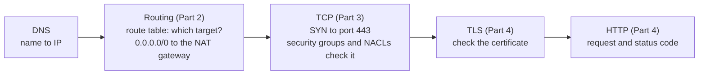

---
tags:
  - study/networking
status: active
created: 2026-11-23
updated: 2026-11-23
---

# 0 - Networking in Plain Language

> [!info] How to use this chapter
> Read this **before** [1 - Fundamentals of Networking](1%20-%20Fundamentals%20of%20Networking.md) and [2 - Internet Protocol (IP)](2%20-%20Internet%20Protocol%20%28IP%29.md). It covers the four ideas that cause the most confusion:
>
> 1. How big an IP block is (CIDR)
> 2. How a machine decides where to send a packet (routing)
> 3. What "connection refused" and "connection timed out" really mean
> 4. The four steps of every HTTPS request
>
> Each part starts with an everyday picture, then gives the real technical version, then a worked example, then a question for you. **Try the question before you open the answer.** Every technical word is explained the first time it appears.

---

## Part 0: The words you need first

Read this table once. You don't need to memorize it, because every word is explained again where it is used.

| Word | Plain meaning | Everyday picture |
| --- | --- | --- |
| **Packet** | A small piece of data sent over a network, with a "to" address and a "from" address written on it. Big data is cut into many packets. | A letter in an envelope |
| **IP address** | The address of a machine on a network, such as `10.0.6.17`. | The postal address of a building |
| **Port** | A number from 0 to 65535 that says which program on the machine should get the packet. A web server usually waits on port 443, and SSH on port 22. | The flat number inside the building |
| **Listening** | A program has told the operating system: "give me anything that arrives on port 443". | Someone is at home in flat 443, waiting for visitors |
| **Router** | A device that passes packets from one network to another. | A post office that sorts letters and sends them closer to their destination |
| **Gateway** (default gateway) | The router your machine hands a packet to when the destination is not on its own network. | Your building's mail room: anything going outside the building goes there |
| **Route table** | A list of rules saying "for addresses in this range, send the packet that way". | The sorting chart on the post office wall |
| **Bit** | One binary digit, 0 or 1. | A light switch: off or on |
| **Octet** | 8 bits together. Each of the four numbers in `10.0.6.17` is one octet, and each can be 0 to 255. | One "chunk" of the address |
| **Subnet** | A range of IP addresses that sit together on one network segment. | One street, with its houses |
| **CIDR block** | A way to write a range of addresses, such as `10.0.4.0/22`. You will learn to read it in Part 1. | "All houses on this street" |
| **Firewall** | Something that allows or blocks packets based on rules. In AWS, the main firewalls are **security groups** and **network ACLs (NACLs)**. | A security guard at the gate |
| **Protocol** | An agreed set of rules for how two sides talk. TCP, TLS, HTTP and DNS are protocols. | The etiquette of a phone call: say hello, talk, say goodbye |

---

## Part 1: IP blocks and CIDR, without the jargon

### 1.1 Why addresses come in blocks

Think of Indian PIN codes. `411001` is a post office in Pune. The first digit, `4`, means the western region, `41` narrows it to part of Maharashtra, and so on. A post office in Delhi does not need to know every post office in Pune. It only needs one rule: **"anything starting with `41`, send towards Pune"**.

IP addresses work the same way. The start of the address says **which network**, and the end says **which machine on that network**. Routers far away only look at the start. Without this, every router in the world would need a separate entry for every machine in the world: billions of entries, changing every second. With it, one rule covers a whole block of machines.

So the most important question about any address range is: **how many leading digits are fixed (the "which network" part), and how many are free (the "which machine" part)?**

### 1.2 What the `/number` means

A CIDR block looks like this: `10.0.4.0/22`.

- `10.0.4.0` is where the block starts.
- `/22` is called the **prefix length**. It means: *the first 22 bits are fixed; every machine in this block has the same first 22 bits.*

An IPv4 address has **32 bits** in total (4 octets × 8 bits). So:

```text
free bits = 32 - prefix length
/22  ->  32 - 22 = 10 free bits
```

The free bits are what change from one machine to the next inside the block.

**Decimal picture first.** Suppose a PIN code is 6 digits and the first 4 are fixed: `4110__`. The 2 free digits can each be 0 to 9, so there are 10 × 10 = **100** PIN codes in that range. Each free decimal digit multiplies the count by 10.

**Binary works the same way, but each free bit multiplies by 2,** because a bit has only two values, 0 and 1.

```text
number of addresses = 2 x 2 x 2 ... (once per free bit) = 2^(free bits)
/22  ->  10 free bits  ->  2^10 = 1,024 addresses
```

The only powers of 2 you need:

| Free bits | 0 | 1 | 2 | 3 | 4 | 5 | 6 | 7 | 8 | 10 | 12 | 16 |
| --- | --- | --- | --- | --- | --- | --- | --- | --- | --- | --- | --- | --- |
| Addresses | 1 | 2 | 4 | 8 | 16 | 32 | 64 | 128 | 256 | 1,024 | 4,096 | 65,536 |

Two things follow from this, and they surprise most beginners:

- **A bigger `/number` means a smaller block.** More bits fixed means fewer bits free. A `/28` has 16 addresses; a `/16` has 65,536.
- **Not every subnet is a `/24`.** A `/24` is just one common size (256 addresses). AWS lets a subnet be anything from `/28` (16 addresses) to `/16` (65,536).

### 1.3 The four easy prefixes: `/8`, `/16`, `/24`, `/32`

These line up exactly with whole octets (whole numbers in the address), so you can read them at a glance:

| Block | Fixed part | Free part | Range |
| --- | --- | --- | --- |
| `10.0.0.0/8` | first octet (`10`) | last three octets | `10.0.0.0` to `10.255.255.255` |
| `10.5.0.0/16` | first two octets (`10.5`) | last two octets | `10.5.0.0` to `10.5.255.255` |
| `10.5.7.0/24` | first three octets (`10.5.7`) | last octet | `10.5.7.0` to `10.5.7.255` |
| `10.5.7.9/32` | all four octets | nothing | just `10.5.7.9` |

A free octet always runs from 0 to 255. That's the whole trick for these four.

### 1.4 Any other prefix: the "odometer" method

Every other prefix, such as `/22` or `/26`, ends **in the middle of an octet**. That octet is only partly free.

**Picture a car's odometer** (the distance counter) with four wheels, where each wheel goes from 0 to 255 instead of 0 to 9. The rightmost wheel turns fastest. A CIDR block is a stretch of that odometer where the left wheels are locked and the right wheels can turn. When the prefix ends in the middle of a wheel, that wheel can only move a few steps.

**The method, in four steps.** Example: `10.0.4.0/22`.

**Step 1. Find the nearest easy prefix at or above it** (`/8`, `/16`, `/24` or `/32`).

```text
/22 -> nearest easy prefix above it is /24
```

**Step 2. Count how far short it is.** That many bits are free in the "partly free" octet. The partly free octet is the last fixed octet of that easy prefix (for `/24`, that's the 3rd octet).

```text
24 - 22 = 2 bits free in the 3rd octet
```

**Step 3. Turn the free bits into a step size.** 2 free bits give 2^2 = **4** values, so the 3rd octet moves in steps of 4. Blocks of this size can only **start** at 0, 4, 8, 12, 16 and so on in that octet.

**Step 4. Write the range.** Round the 3rd octet down to a multiple of 4, which is 4. The block covers 4 values: 4, 5, 6, 7. Every octet to the right of it is fully free, 0 to 255.

```text
start: 10.0.4.0
end:   10.0.7.255
size:  4 values of the 3rd octet x 256 values of the 4th = 1,024   (matches 2^10, good)
```

**A second example, in the last octet:** `192.168.1.130/26`.

```text
Step 1: nearest easy prefix above /26 is /32 -> the partly free octet is the 4th
Step 2: 32 - 26 = 6 free bits
Step 3: 2^6 = 64, so blocks start at 0, 64, 128, 192 in the 4th octet
Step 4: 130 rounded down to a multiple of 64 is 128
        range 192.168.1.128 to 192.168.1.191 (128 + 64 - 1 = 191), size 64
```

Notice that `.130` is not the start. The address someone gives you can be **any address inside the block**; you round down to find where the block starts.

**A third example:** `10.20.25.9/20`.

```text
Step 1: nearest easy prefix above /20 is /24 -> the 3rd octet is partly free
Step 2: 24 - 20 = 4 free bits
Step 3: 2^4 = 16, so the 3rd octet starts at 0, 16, 32, 48...
Step 4: 25 rounds down to 16 -> 16, 17, ... 31 (16 values)
        range 10.20.16.0 to 10.20.31.255, size 16 x 256 = 4,096
```

**Is an address inside the block?** Check that the octets to the left match, and that the partly free octet falls inside the range. `10.0.6.17` is inside `10.0.4.0/22` (6 is in 4 to 7). `10.0.8.5` is outside (8 is where the *next* block starts).

### 1.5 The AWS twist: five addresses you can't use

In every AWS subnet, AWS keeps five addresses for itself:

| Address in the block | Used for |
| --- | --- |
| The first one (for example `.0`) | The network address, the name of the block itself |
| first + 1 | The VPC router: your subnet's default gateway |
| first + 2 | The Amazon DNS server |
| first + 3 | Reserved for future use |
| The last one (for example `.255`) | The broadcast address. A VPC has no broadcast, but AWS reserves it anyway |

So a `/24` gives 256 − 5 = **251** usable addresses, and a `/28` gives only 16 − 5 = **11**. This matters when you size a subnet for EKS (AWS's managed Kubernetes), where every Pod can take its own VPC address.

> [!question]- Check yourself: how many addresses are in `10.1.130.7/23`, and what is the range? (Try it first.)
> Nearest easy prefix above `/23` is `/24`, so the 3rd octet is partly free. 24 − 23 = 1 free bit, so the step is 2^1 = 2, and blocks start at even numbers. 130 is already even. The range is `10.1.130.0` to `10.1.131.255`, which is 2 × 256 = **512** addresses (2^9, since 32 − 23 = 9 free bits). In AWS, 507 of them are usable.

> [!question]- Check yourself: is `192.168.5.77` inside `192.168.5.64/28`?
> `/28` is 4 short of `/32`, so the 4th octet has 4 free bits and a step of 16. Blocks start at 0, 16, 32, 48, **64**, 80... The block runs from 64 to 79. 77 is between them, so **yes, it's inside**.

---

## Part 2: How a machine decides where to send a packet

### 2.1 The everyday picture

You are in a large apartment complex with a mail room at the gate.

- If your letter is for **someone in your own complex**, you walk over and deliver it yourself.
- If it is for **anyone outside**, you drop it at the mail room, and the mail room works out the rest.

Every computer makes exactly this decision for every packet:

1. **Is the destination inside my own subnet?** If yes, deliver it directly.
2. **If not**, send it to the **default gateway** (the mail room), which is a router.

When the packet goes via the gateway, the **IP address written on the packet doesn't change**. It still says the final destination. The computer just hands it to the gateway first, the way you hand a letter to the mail room without changing the address on the envelope.

### 2.2 The route table: the sorting chart

A router, and also every computer and every AWS subnet, has a **route table**: a short list of rules in the form "for this range of addresses, send it to that place". The "place" is called the **target** or **next hop**.

A typical AWS route table for a private subnet:

| Destination | Target | Plain meaning |
| --- | --- | --- |
| `10.0.0.0/16` | `local` | "Anything inside our own VPC: deliver it within the VPC." |
| `10.1.0.0/16` | `pcx-...` (a VPC peering connection) | "Anything in the partner VPC: send it over the peering link." |
| `0.0.0.0/0` | `nat-...` (a NAT gateway) | "Everything else: send it to the NAT gateway, which takes it to the internet." |

`0.0.0.0/0` has **0 fixed bits**, so by Part 1 it matches **every** IPv4 address. It is the "everything else" rule, called the **default route**.

### 2.3 Longest prefix match: the most specific rule wins

Now there's a puzzle. A packet for `10.0.3.7` matches `10.0.0.0/16`, and it **also** matches `0.0.0.0/0`, because that matches everything. Which rule applies?

**Everyday picture.** A post office sorting chart says:

- "Anything for India: tray A"
- "Anything for Maharashtra: tray B"
- "Anything for Pune 411001: tray C"

A letter for Pune 411001 matches all three. Common sense says tray C, **the most specific rule**, because it was written for exactly this case. The broad rules are there for everything that *doesn't* have a more specific rule.

Routers use the same common sense, and the technical name is **longest prefix match**: among all the rules that match, use the one with the **largest `/number`**, because that means the most fixed bits, the narrowest range, and the most specific rule. The order the rules are listed in doesn't matter.

**Worked examples, using the table in 2.2:**

| Packet going to | Rules that match | Winner | Why |
| --- | --- | --- | --- |
| `10.0.3.7` | `10.0.0.0/16`, `0.0.0.0/0` | `local` | `/16` is more specific than `/0` |
| `10.1.9.9` | `10.1.0.0/16`, `0.0.0.0/0` | peering | `/16` beats `/0` |
| `8.8.8.8` | only `0.0.0.0/0` | NAT gateway | it's the only match |
| `10.2.0.5` | only `0.0.0.0/0` | NAT gateway | It looks "internal" because it starts with 10, but no rule covers `10.2.x.x`, so it goes to the default route. The NAT gateway can't reach a private address on the internet, so this traffic fails. |

The last row is the classic trap: **a route table doesn't know what "internal" means. It only compares numbers.**

**Why this rule is useful.** You can set a broad rule (the default route) once, and add exceptions later just by adding narrower rules, without touching the broad one. AWS uses this for the S3 gateway endpoint: it adds rules for S3's address ranges that are more specific than `0.0.0.0/0`, so S3 traffic skips the NAT gateway automatically.

> [!question]- Check yourself: a route table has `10.0.0.0/8 -> A`, `10.10.0.0/16 -> B` and `10.10.5.0/24 -> C`. Where does a packet for `10.10.5.20` go? And one for `10.10.9.1`?
> `10.10.5.20` matches all three rules; `/24` is the most specific, so it goes to **C**. `10.10.9.1` is not inside `10.10.5.0/24` (its 3rd octet is 9, not 5), so it matches only `/8` and `/16`; the `/16` wins, so it goes to **B**.

---

## Part 3: "Connection refused" versus "connection timed out"

### 3.1 First, how a TCP connection starts

**TCP** is the protocol most applications use to talk reliably: web, SSH, databases. Before any data is sent, the two sides do a short greeting called the **three-way handshake**. Think of a phone call:

```text
You:    "Hello, can you hear me?"            -> SYN      ("synchronize": I want to connect)
Them:   "Yes, I hear you. Can you hear me?"  -> SYN-ACK  ("I agree, and acknowledge you")
You:    "Yes."                               -> ACK      (connection is open)
```

Everything in this part is about **what happens after your first "hello" (the SYN)**.

### 3.2 The three possible outcomes

**Picture: you send a letter to flat 443 in a building.**

| What happens | Letter picture | TCP reality | What your program shows |
| --- | --- | --- | --- |
| **1. A reply comes** | The person in flat 443 writes back. | The server replies with SYN-ACK: a program is listening on that port. | Connected |
| **2. A "return to sender" comes** | The letter **reached the building**, but nobody lives in flat 443, so the building sends it back: "no such person here". | The packet reached the machine, but **no program is listening on that port**, so the machine's operating system replies with a **RST** (reset), meaning "nobody here". | `Connection refused` |
| **3. Nothing ever comes** | The letter was lost or thrown away somewhere. You don't know where. You wait, then give up. | The packet, or its reply, was **silently dropped** on the way. | `Connection timed out` |

The key lesson is **how far the packet got**:

- **Refused** means the network path **worked**. You reached the machine. The problem is **on the machine**: the app isn't running, it's on a different port, or it only listens to itself (more below).
- **Timed out** means something **in between** dropped it: a firewall, a missing route, or a machine that is switched off.

"Refused" sounds worse than "timed out", but it's actually the better news: you know the whole network path is fine.

### 3.3 Why AWS firewalls cause timeouts, never refusals

**Picture: a security guard at the gate** who has a list of allowed visitors. If you're not on the list, the guard **doesn't send a polite reply**. The guard just shreds your letter. You hear nothing.

AWS **security groups** and **network ACLs** behave exactly like that guard: they **drop** blocked packets **silently**. They never send back a "refused". So:

- Blocked by a security group or NACL → **timed out**
- Refused → the security groups and NACLs **let you through**; look at the app on the machine

**One extra detail about the two AWS guards:**

- A **security group** is a guard with a good memory (**stateful**). If it let your request go out, it automatically lets the reply come back in.
- A **network ACL** is a guard with no memory (**stateless**). It checks every packet in each direction against its list separately. If you forget to allow the **reply** direction, the reply is dropped, and the result is again a timeout. Replies come back to a temporary high-numbered port on the client (called an **ephemeral port**, usually somewhere in 1024 to 65535), so a NACL must allow that range for return traffic.

### 3.4 "The app is running, but connections are refused"

A program can choose **which of the machine's addresses** it listens on:

- Listening on `127.0.0.1` (the machine's name for **itself**, called **loopback**) means: "I only accept visitors **from inside this machine**." Others get **refused**.
- Listening on `0.0.0.0` means: "I accept visitors **on all of this machine's addresses**", so other machines can reach it.

Picture a shop that only opens its **back door** to staff. Customers at the front door are turned away. To see which ports a Linux machine is listening on, and on which address, run `ss -tlnp` (Linux block, Week 1).

> [!question]- Check yourself: you run `curl http://10.0.2.15:8080` from another EC2 instance and get `Connection refused`. Is a security group blocking you?
> **No.** Security groups drop silently, so a blocked request would **time out**. "Refused" proves your packet reached `10.0.2.15` and the machine answered "nobody listening on 8080". Check on that machine: is the app running? Is it on port 8080? Is it listening on `127.0.0.1` only? `ss -tlnp` answers all three.

> [!question]- Check yourself: the same command gives `Connection timed out` instead. Name three possible causes.
> Anything that silently drops the packet or its reply: the target's **security group** doesn't allow port 8080 from your source; a **network ACL** blocks the request or the reply on the ephemeral ports; a **route** is missing in either direction; or the instance is **stopped**. VPC Flow Logs show `REJECT` entries when a security group or NACL dropped the traffic.

---

## Part 4: The four steps of every HTTPS request

### 4.1 The everyday picture: calling a business

Suppose you want to order something by phone from "ABC Stores".

1. **Look up the number.** You know the name, not the number, so you check a directory. → **DNS**
2. **Dial and get connected.** The call rings and someone picks up. → **TCP**
3. **Check who you're talking to and agree on a private language.** They read out their ID, which you check against a trusted authority, and you agree on a code so nobody listening can understand. → **TLS**
4. **Place your order and get an answer.** "One kilo of rice, please." "Sorry, out of stock." → **HTTP**

### 4.2 The same steps, technically

| Step | Protocol | What it does | Plain version |
| --- | --- | --- | --- |
| 1 | **DNS** (Domain Name System) | Turns a name like `api.example.com` into an IP address | The phone directory |
| 2 | **TCP** | Opens a connection to that IP on port 443 (the three-way handshake from Part 3) | The call connects |
| 3 | **TLS** (Transport Layer Security) | The server shows its **certificate**, a digital ID card signed by a trusted authority. Your side checks it is valid, not expired, and for the right name. Then both agree on encryption keys. | Check their ID, agree on a secret code |
| 4 | **HTTP** | Your request ("GET /orders") and the server's reply, with a **status code** such as 200 (OK) or 503 (service unavailable) | The actual conversation |

**HTTPS** is simply HTTP sent inside a TLS-protected conversation.

### 4.3 Why the order can't change

Each step needs the one before it:

- You can't connect (TCP) without an IP address, and DNS gives you that.
- TLS messages are **carried over the TCP connection**, so TLS can't start before TCP is connected. You can't check someone's ID before the call connects.
- You shouldn't send your order (HTTP), which may include passwords or tokens, until the line is secure (TLS).

So it's always **DNS → TCP → TLS → HTTP**. A common mistake is to put TLS before TCP, but TLS rides inside TCP, the same way a coded message is spoken *over* a phone call that's already connected.

### 4.4 Reading an error: which step failed?

An error tells you **the step that failed**, and that every step before it **worked**:

| Error you see | Failed at | So these worked |
| --- | --- | --- |
| `Could not resolve host` | DNS | nothing yet |
| `Connection refused` or `Connection timed out` | TCP (Part 3 tells you which kind) | DNS |
| `certificate has expired`, `certificate verify failed`, `SSL certificate problem` | TLS | DNS and TCP: the server is reachable |
| **Any HTTP status code**: 403, 404, 500, 502, **503** | not a network failure | DNS, TCP and TLS: the whole network path works, and the server (or load balancer) *chose* that reply |

The last row is the one people get wrong most: **a 503 is not a network problem.** In the phone picture, the shop picked up, proved who they were, and said "sorry, we can't serve you right now". The phone line was fine. With a load balancer in front, a 503 often means the load balancer is working but has no healthy servers behind it.

### 4.5 Seeing the steps yourself

`curl -v` ("verbose") prints each step as it happens. The output looks roughly like this (exact wording varies by curl version):

```text
* Host api.example.com:443 was resolved.     <- step 1, DNS worked
*   Trying 93.184.215.14:443...
* Connected to api.example.com (93.184.215.14) port 443   <- step 2, TCP worked
* SSL connection using TLSv1.3 / ...          <- step 3, TLS worked
> GET / HTTP/2                                <- step 4, your request
< HTTP/2 503                                  <- step 4, the server's answer
```

When something fails, **the last line printed before the error tells you which step died.**

> [!question]- Check yourself: a user sees `SSL certificate problem: certificate has expired`. Is the server down? Is DNS broken?
> Neither. A certificate error is the **TLS** step, which happens **after** DNS and TCP. So DNS found the address, and TCP connected to a running server that sent its certificate. The fix is to renew the certificate, not to debug the network.

> [!question]- Check yourself: put these in order, and say why TLS can't come first: HTTP request, TLS handshake, DNS lookup, TCP handshake.
> DNS lookup → TCP handshake → TLS handshake → HTTP request. TLS messages travel **inside** the TCP connection, so there is nothing to carry them until TCP is connected. And TCP needs the IP address that DNS provides.

---

## How the four parts connect

One request uses all four parts. An app in a private AWS subnet calls `https://api.example.com`:



And Part 1 sits under all of it: the route table, the security group rules and the subnet are all written as CIDR blocks.

## Small Details That Matter Later

- **A bigger `/number` is a smaller block.** `/28` (16 addresses) is tiny and `/16` (65,536) is huge. Mixing this up is the most common CIDR mistake.
- **Blocks always start on a multiple of their step size.** `10.0.5.0/22` is not a real block start. The block that contains it starts at `10.0.4.0`. Most tools quietly round down or refuse such an address.
- **Two CIDR blocks never partly overlap.** Either they share no addresses, or one sits completely inside the other. **Inside counts in both directions:** their `/17` inside your `/16` is an overlap, and so is your `/16` inside their `/8`. VPC peering, Transit Gateway routing and VPNs need ranges that share no addresses. With an overlap, each side's `local` route claims the other side's addresses, so packets never cross.
- **AWS takes 5 addresses from every subnet**, so a `/28` holds only 11 usable addresses.
- **Route tables compare numbers, not meanings.** A `10.x` address with no matching route goes to the default route like any internet address.
- **The order of rules in a route table doesn't matter**; the most specific match wins. (Security group rules have no order at all. NACL rules *are* checked in number order, which is a different mechanism, taught with VPCs.)
- **Refused means you reached the machine; timed out means something in between dropped you.** AWS security groups and NACLs only ever cause timeouts.
- **An app listening on `127.0.0.1` refuses everyone except itself.**
- **NACLs need the reply direction allowed too** (ephemeral ports); security groups don't.
- **Any HTTP status code proves the network works.** A 503 from a load balancer usually means no healthy servers behind it, not a network fault.
- **`ping` failing proves little.** Ping uses ICMP, a separate protocol that security groups block unless you allow it, so ping can fail while TCP works fine.

## Where to go deeper

| Part here | Full version |
| --- | --- |
| Part 1, CIDR | [2 - Internet Protocol (IP)](2%20-%20Internet%20Protocol%20%28IP%29.md), "Step-by-Step Explanation: Working With CIDR by Hand", including the binary view of why the method works |
| Part 2, routing | [2 - Internet Protocol (IP)](2%20-%20Internet%20Protocol%20%28IP%29.md), "Internal Mechanics" (local or gateway, route tables, default route, ARP) |
| Part 3, connection errors | [1 - Fundamentals of Networking](1%20-%20Fundamentals%20of%20Networking.md), "TCP Basics" and "What a connection attempt can return" |
| Part 4, request steps | [1 - Fundamentals of Networking](1%20-%20Fundamentals%20of%20Networking.md), "HTTP And HTTPS", "DNS" and "Small Details That Matter Later" |
