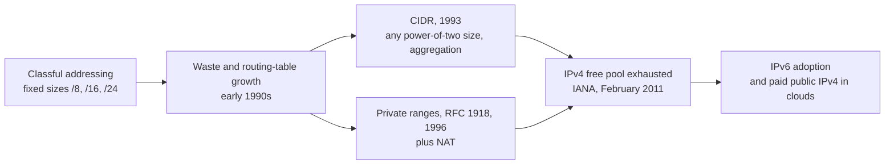
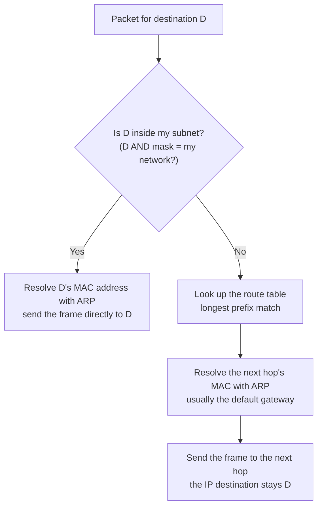
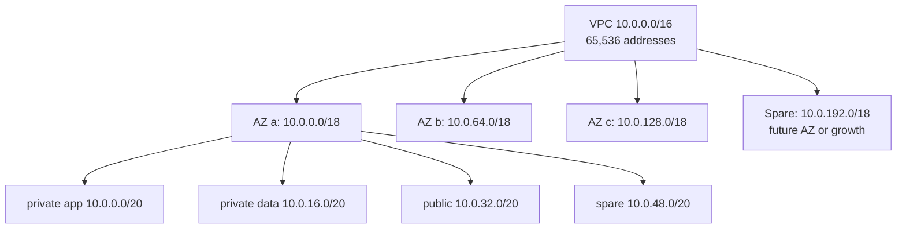

# 2 - Internet Protocol (IP)

> [!tip] New to this, or finding it dense?
> Start with [0 - Networking in Plain Language](0%20-%20Networking%20in%20Plain%20Language.md). It explains CIDR, routing, connection errors and the DNS, TCP, TLS, HTTP order with everyday analogies and no assumed jargon, then links back here.

## Quick Summary

Internet Protocol, usually called IP, is the addressing and routing system that lets devices send packets across networks. IP answers two major questions:

- What is the destination address?
- Which next hop should the packet use to get closer to that destination?

IP does not guarantee delivery by itself. Reliability, ordering, retries, and application behavior are handled by higher layers such as TCP or by the application.

The single most useful skill in this chapter is reading a CIDR block such as `10.0.4.0/22` and knowing, by hand, how big it is, where it starts and ends, and whether a given address is inside it. Almost every cloud, Kubernetes and firewall decision builds on that skill.

## Why This Chapter Matters

IP knowledge is required for:

- Subnet design.
- Cloud VPC design.
- Kubernetes Service and Pod networking.
- Firewall rules.
- VPNs and private connectivity.
- Troubleshooting routing, NAT, and connectivity problems.

If you understand IP, cloud networking becomes much less mysterious. If you don't, you end up copying `/16` and `/24` from examples without knowing what they cost you, and the cost arrives later: a Kubernetes cluster that runs out of Pod addresses, two VPCs that can never be peered because their ranges overlap, or a firewall rule that silently allows four times more addresses than intended.

## The Big Picture

An IP address is not one flat number. It has two parts:

```text
10.0.6.17 / 22
└── network part (first 22 bits): which block, which "street"
    host part (last 10 bits): which machine inside that block, which "house"
```

Routers only care about the network part. A router does not need to know where every single machine is; it needs to know which direction each *block* lies in. That one idea explains why IP addresses are grouped into blocks, why route tables stay small enough to work, and why the prefix length (`/22`) is the most important number you will read in cloud networking.

Benefits of this design:

- IP gives a common addressing system across networks.
- Routing lets networks scale beyond one LAN.
- CIDR allows flexible address allocation.
- Private addressing makes internal networks practical.
- IPv6 gives a much larger address space.

## First-Principles Explanation

**The problem.** A packet has to travel from one machine to another through many routers, across networks owned by different organizations. Each router must decide, in microseconds, which neighbour to hand the packet to next.

**What fails without structure.** Suppose every address were a standalone number with no grouping. Every router on the internet would need one entry per machine: billions of entries, changing every time a laptop joins a Wi-Fi network. The tables would not fit in router memory, lookups would be too slow, and every change would have to be announced to every router in the world. Routing would collapse.

**The design.** Give addresses a hierarchy. All machines on one network share the same leading bits (the network prefix). A router far away keeps one entry for the whole block: "anything starting with these bits goes that way". Only the routers close to the block need finer detail. This is called **aggregation**, and it is the reason the internet's routing table holds roughly a million routes rather than billions.

**The consequence.** Because a block is defined by fixed leading bits, every block has a size that is a power of two and starts on a boundary that is a multiple of its size. Those two facts are what make CIDR arithmetic possible by hand, and they are the source of most beginner mistakes.

## Core Vocabulary

| Concept | Meaning |
| --- | --- |
| IP address | Logical address assigned to a network interface. |
| Bit | A single binary digit, 0 or 1. An IPv4 address is 32 bits. |
| Octet | A group of 8 bits, written as one decimal number from 0 to 255. An IPv4 address has four. |
| Network prefix | The network part of an address. The prefix length, such as `/24`, says how many leading bits it has. |
| Host portion | The remaining bits, used to identify a host inside the subnet. |
| CIDR | Classless Inter-Domain Routing. Notation for IP ranges, such as `10.0.1.0/24`, where the block can be any power-of-two size. |
| CIDR block | One contiguous range of addresses described by a start address and a prefix length. |
| Subnet | A range of IP addresses grouped together, usually one CIDR block attached to one network segment. |
| Subnet mask | The prefix length written as an address: `/24` is `255.255.255.0`. Same information, different format. |
| Network address | The first address of a block, all host bits 0. Identifies the block itself. |
| Broadcast address | The last address of a block, all host bits 1. Traditionally "every host on this subnet". |
| Block size | How far apart consecutive blocks of a given prefix start, measured in the octet where the prefix ends. |
| Aggregation (summarization) | Describing several adjacent blocks with one shorter prefix, such as four `/24`s as one `/22`. |
| Route | Rule that says where to send packets for a destination range. |
| Default gateway | Router used when the destination is outside the local subnet and no more specific route matches. |
| Public IP | Internet-routable address. |
| Private IP | Address reserved for internal networks. |
| NAT | Address translation, often private-to-public for outbound internet. |

## Mental Model

Think of a CIDR block as **a run of houses on a street, where the run's length is always a power of two and it always starts at a multiple of that length.**

- `/24` is a run of 256 addresses that starts at a multiple of 256: `x.y.z.0` to `x.y.z.255`.
- `/22` is a run of 1,024 addresses that starts where the third octet is a multiple of 4: for example `10.0.4.0` to `10.0.7.255`.
- `/28` is a run of 16 addresses that starts where the fourth octet is a multiple of 16: for example `10.0.1.32` to `10.0.1.47`.

Two rules fall out of this model:

```text
larger prefix number = more fixed bits = smaller network
smaller prefix number = fewer fixed bits = larger network
```

- `/24` is smaller than `/16`.
- `/32` is one IPv4 address.
- `/0` means all IPv4 addresses.

## Historical / Evolution / Causal Chain



1. **Classful addressing (from 1981).** Early IPv4 had three main fixed sizes. Class A blocks were `/8` (16.7 million addresses), class B were `/16` (65,536), class C were `/24` (256). An organization needing 2,000 addresses was too big for a class C, so it got a class B and wasted over 63,000 addresses.
2. **The crisis.** By the early 1990s, class B space was running out and routers were drowning in class C routes, because organizations took many `/24`s instead of one big block.
3. **CIDR (1993, RFC 1518 and 1519, today RFC 4632).** Prefixes became any length. An organization needing 2,000 addresses could get a `/21` (2,048). Providers could aggregate many customers' blocks into one route. This is the notation you use today.
4. **Private addressing and NAT (RFC 1918, 1996).** Three ranges were set aside for internal use, reusable by everyone, with NAT translating to a shared public address at the edge. This bought IPv4 decades of extra life, at the cost that private networks of different organizations now overlap, which is why VPNs and VPC peering so often fail on overlapping ranges.
5. **Exhaustion (2011).** IANA handed out the last free IPv4 blocks to the regional registries in February 2011. Public IPv4 became scarce and tradable; AWS began charging for every public IPv4 address in February 2024 (verify current pricing).
6. **IPv6.** 128-bit addresses remove scarcity, but adoption is gradual, so most cloud networks still revolve around IPv4 private ranges, CIDR planning and NAT.

## Architecture or Conceptual Structure

### IPv4 Addressing

IPv4 uses 32-bit addresses, usually written as four decimal octets. That gives 2^32, about 4.29 billion, possible addresses.

```text
192.168.1.25
```

Each octet ranges from 0 to 255, because 8 bits can hold 2^8 = 256 values.

```text
192      .168      .1        .25
11000000 10101000 00000001  00011001
```

Bit values inside one octet, from left to right: `128 64 32 16 8 4 2 1`. For example, `4` is `00000100` and `252` is `11111100`.

### IPv6 Addressing

IPv6 uses 128-bit addresses and is written in hexadecimal groups.

```text
2001:db8:1234:abcd::10
```

Why IPv6 exists:

- IPv4 address space is limited.
- IPv6 provides a much larger address space (2^128 addresses).
- IPv6 reduces the need for NAT in many designs.
- IPv6 supports modern network features, but adoption varies by environment.

Important: IPv6 is not just "longer IPv4". It has different address types, neighbor discovery behavior, and operational patterns. Subnets are conventionally `/64`; AWS gives a VPC an IPv6 block of `/56` and each subnet a `/64` by default (verify against current AWS docs).

### Public And Private IPv4 Ranges

Private IPv4 ranges are not routed directly on the public internet.

| Range | CIDR | Common Use |
| --- | --- | --- |
| 10.0.0.0 - 10.255.255.255 | `10.0.0.0/8` | Large private networks and cloud VPCs. |
| 172.16.0.0 - 172.31.255.255 | `172.16.0.0/12` | Medium private networks; Docker's default bridge uses `172.17.0.0/16` from this space. |
| 192.168.0.0 - 192.168.255.255 | `192.168.0.0/16` | Home and small office networks. |

Special ranges:

| Range | Purpose |
| --- | --- |
| `127.0.0.0/8` | Loopback; `127.0.0.1` means the local machine. |
| `169.254.0.0/16` | Link-local IPv4, often automatic fallback addressing. AWS serves instance metadata at `169.254.169.254` from this range. |
| `100.64.0.0/10` | Shared address space for carrier-grade NAT (RFC 6598). Sometimes added to VPCs as extra space for Kubernetes Pods (verify against current EKS docs). |
| `0.0.0.0/0` | Default route, meaning any IPv4 destination. |
| `255.255.255.255` | Limited broadcast address. |

## Step-by-Step Explanation: Working With CIDR by Hand

### CIDR Notation

CIDR format:

```text
network-address/prefix-length
```

Example:

```text
192.168.1.0/24
```

This means:

- First 24 bits are the network part.
- Remaining 8 bits are host addresses.
- Total addresses: `2^8 = 256`.

For traditional IPv4 subnets, usable host count is often:

```text
2^(host bits) - 2
```

The subtraction accounts for network and broadcast addresses. Some cloud providers reserve additional addresses inside each subnet: AWS reserves five (see "Small Details That Matter Later").

### The four-step method

Use this for any block. The worked example is `10.0.4.0/22`.

**Step 1: size.** Host bits = 32 − prefix. Size = 2^(host bits).

```text
32 - 22 = 10 host bits  ->  2^10 = 1024 addresses
```

**Step 2: find the octet where the prefix ends, and its block size.**

| Prefix range | The prefix ends in | Bits fixed in that octet |
| --- | --- | --- |
| `/1` to `/8` | first octet | prefix |
| `/9` to `/16` | second octet | prefix − 8 |
| `/17` to `/24` | third octet | prefix − 16 |
| `/25` to `/32` | fourth octet | prefix − 24 |

For `/22`: third octet, 22 − 16 = 6 bits fixed, so 8 − 6 = 2 bits free. Block size = 2^2 = **4**.

**Step 3: range.** Blocks start at multiples of the block size in that octet. Round the octet down to a multiple of 4, then add block size − 1 for the end. Every octet to the right runs from 0 to 255.

```text
third octet 4 is already a multiple of 4
start: 10.0.4.0
end:   10.0.(4 + 4 - 1).255 = 10.0.7.255
check: 4 values (4, 5, 6, 7) x 256 = 1024
```

**Step 4: membership.** An address is inside the block if its octets to the left match and the "interesting" octet falls inside the range.

```text
10.0.6.17  -> third octet 6 is in 4..7  -> inside
10.0.8.5   -> third octet 8 is the start of the next block (10.0.8.0/22) -> outside
```

### Why the method works: the binary view

```text
10.0.4.0/22
00001010 . 00000000 . 000001|00 . 00000000
<-------- 22 fixed bits ------>|<- 10 free bits ->
```

The first six bits of the third octet, `000001`, are fixed. The last two bits can be `00`, `01`, `10` or `11`, which turns the third octet into 4, 5, 6 or 7. The fourth octet is entirely free, 0 to 255. That is the whole range, and it is why the block size is 4.

### More worked examples

| Address and prefix | Block size | Block | Range | Size |
| --- | --- | --- | --- | --- |
| `172.16.37.200/27` | 32 in the fourth octet | `172.16.37.192/27` | `172.16.37.192` to `172.16.37.223` | 32 |
| `192.168.1.130/26` | 64 in the fourth octet | `192.168.1.128/26` | `192.168.1.128` to `192.168.1.191` | 64 |
| `10.20.25.9/20` | 16 in the third octet | `10.20.16.0/20` | `10.20.16.0` to `10.20.31.255` | 4,096 |
| `10.0.0.0/18` | 64 in the third octet | `10.0.0.0/18` | `10.0.0.0` to `10.0.63.255` | 16,384 |

Read the first row slowly: 200 is not a multiple of 32, so round down to the nearest multiple, 192. The block runs 32 addresses from there, ending at 223.

### Prefix lengths and subnet masks

The mask is the prefix written as an address: 1s for fixed bits, 0s for free bits. In the octet where the prefix ends, the mask value is **256 − block size**.

| CIDR | Subnet Mask | Total Addresses | Common Use |
| --- | --- | --- | --- |
| `/32` | `255.255.255.255` | 1 | Single host route; a single IP in a security group rule. |
| `/30` | `255.255.255.252` | 4 | Point-to-point links in traditional networks. |
| `/28` | `255.255.255.240` | 16 | Smallest subnet AWS allows. |
| `/27` | `255.255.255.224` | 32 | Small subnet. |
| `/26` | `255.255.255.192` | 64 | Small subnet. |
| `/24` | `255.255.255.0` | 256 | Common LAN subnet. |
| `/22` | `255.255.252.0` | 1,024 | Medium subnet. |
| `/20` | `255.255.240.0` | 4,096 | Larger subnet; good default for Kubernetes node subnets. |
| `/18` | `255.255.192.0` | 16,384 | One Availability Zone's share of a `/16`. |
| `/16` | `255.255.0.0` | 65,536 | Large private network; the largest IPv4 block AWS allows for a VPC. |
| `/8` | `255.0.0.0` | 16,777,216 | Very large network range. |

### Splitting and combining blocks

**Splitting (subnetting).** Each extra prefix bit halves the block. A `/16` holds 2 `/17`s, 4 `/18`s, 16 `/20`s or 256 `/24`s. In general, a `/a` holds 2^(b − a) blocks of `/b`.

```text
10.0.0.0/16 into four /18s:
10.0.0.0/18   10.0.64.0/18   10.0.128.0/18   10.0.192.0/18
```

**Combining (aggregation).** Adjacent, aligned blocks combine into one shorter prefix. `10.1.0.0/24`, `10.1.1.0/24`, `10.1.2.0/24` and `10.1.3.0/24` together are exactly `10.1.0.0/22`. A route table, firewall rule or VPN configuration can then use one entry instead of four.

### Simple subnetting example

You have:

```text
10.0.0.0/16
```

You want smaller `/24` subnets:

```text
10.0.1.0/24
10.0.2.0/24
10.0.3.0/24
```

Each `/24` has 256 total addresses (251 usable on AWS).

| Subnet | Purpose |
| --- | --- |
| `10.0.1.0/24` | Public subnet in Availability Zone A. |
| `10.0.2.0/24` | Private app subnet in Availability Zone A. |
| `10.0.3.0/24` | Private database subnet in Availability Zone A. |
| `10.0.11.0/24` | Public subnet in Availability Zone B. |
| `10.0.12.0/24` | Private app subnet in Availability Zone B. |
| `10.0.13.0/24` | Private database subnet in Availability Zone B. |

This layout is easy to read, but it is small: about 250 usable addresses per app subnet. That is fine for a few EC2 instances and too small for an EKS cluster where every Pod takes a VPC address. The next layout leaves room to grow.

## Internal Mechanics

### How a host decides: local delivery or the gateway

Every time a host sends a packet, it asks one question: is the destination on my own subnet?



Worked example, host `10.0.4.10/22`, mask `255.255.252.0`:

- To `10.0.6.17`: `10.0.6.17 AND 255.255.252.0 = 10.0.4.0`, the host's own network, so it delivers directly.
- To `10.0.8.5`: `10.0.8.5 AND 255.255.252.0 = 10.0.8.0`, a different network, so it sends to the gateway.

Notice the last box: when a packet goes through a gateway, the **frame** is addressed to the gateway's MAC address, but the **IP destination** never changes. That separation between layer 2 (frames, MAC) and layer 3 (packets, IP) is what lets a packet cross many networks.

### Route Tables

A route table decides where packets go.

Example Linux route table:

```text
default via 192.168.1.1 dev wlan0
192.168.1.0/24 dev wlan0
```

Meaning:

- Traffic for `192.168.1.0/24` stays on local Wi-Fi.
- Everything else goes to gateway `192.168.1.1`.

Route selection uses **longest prefix match**: among all routes whose block contains the destination, the one with the longest prefix (the most specific) wins.

| Route | Destination Match |
| --- | --- |
| `10.0.0.0/8` | Broad match. |
| `10.10.0.0/16` | More specific. |
| `10.10.5.0/24` | Most specific. |

If traffic is going to `10.10.5.20`, all three routes contain it, and the `/24` route wins because it is the most specific match. Traffic to `10.10.9.1` matches only the `/8` and the `/16`, so the `/16` wins.

Why this rule exists: it lets a general rule (the default route) coexist with any number of exceptions, without ordering problems. To send some traffic somewhere special, you add a more specific route and leave the default alone. AWS uses this for gateway VPC endpoints: the S3 endpoint adds routes for S3's address ranges that are more specific than `0.0.0.0/0`, so S3 traffic bypasses the NAT gateway.

### Default Route

The default route catches traffic that does not match a more specific route.

IPv4 default route:

```text
0.0.0.0/0
```

IPv6 default route:

```text
::/0
```

A `/0` fixes zero bits, so it matches every address, and it is also the least specific route possible, so it loses to any other match. In a home network, default traffic usually goes to the router. In AWS, default traffic might go to an internet gateway, NAT gateway, transit gateway, virtual private gateway, or other target depending on subnet purpose.

### ARP

Address Resolution Protocol maps IPv4 addresses to MAC addresses on the local network.

```text
Who has 192.168.1.10?
192.168.1.10 is at aa:bb:cc:dd:ee:ff
```

ARP matters only for local link delivery. If the destination IP is outside the local subnet, the host sends the frame to the default gateway MAC address, not directly to the remote server MAC address.

Useful command:

```bash
ip neigh
```

In an AWS VPC there is no real broadcast. The VPC's networking layer answers ARP requests itself, which is one reason the broadcast address is reserved but unused.

### ICMP

ICMP is used for control and diagnostic messages.

Common examples:

- Echo request/reply, used by `ping`.
- Destination unreachable.
- Time exceeded, used by traceroute-style tools.

Important: ICMP can be blocked, rate-limited, or treated differently by networks. A failed ping does not always mean the host or service is down. On AWS, security groups don't allow inbound ICMP unless you add a rule for it, so `ping` to an instance often fails while TCP works fine.

### NAT And IP

NAT changes addresses and sometimes ports.

Outbound NAT example:

```text
private host 10.0.2.15 -> NAT gateway public IP -> internet
```

Why NAT is used:

- Let private IP systems reach the internet.
- Hide internal addressing.
- Conserve IPv4 addresses.
- Publish internal services through port forwarding.

Drawbacks:

- Makes logs harder to interpret.
- Can break protocols that embed IP addresses.
- Adds state and scaling limits.
- Does not replace firewall rules.

NAT is covered in depth in [Fundamentals of Networking](1%20-%20Fundamentals%20of%20Networking.md), "NAT".

## Practical Examples

### Public Cloud IP Design

Cloud networks usually separate:

- VPC/VNet CIDR block.
- Public subnets.
- Private application subnets.
- Private database subnets.
- Route tables.
- NAT gateways.
- Internet gateways.
- Security groups/firewall rules.

Good practice:

```text
public subnet: load balancers, NAT gateways, bastions if required
private app subnet: application servers, containers, internal services
private database subnet: databases and stateful systems
```

Avoid putting databases in public subnets unless there is a strong, reviewed reason.

### A VPC address plan with room to grow

Split a `/16` first by Availability Zone, then by tier. Every AZ's subnets then sit inside one `/18`, which keeps the plan readable and summarizable.



AZ b repeats the pattern from `10.0.64.0` (app `10.0.64.0/20`, data `10.0.80.0/20`, public `10.0.96.0/20`, spare `10.0.112.0/20`), and AZ c from `10.0.128.0`. Each `/20` has 4,091 usable addresses on AWS: enough for an EKS node group with thousands of Pods. Public subnets rarely need a `/20`; shrink them if address space is tight.

### Kubernetes IP Concepts

Kubernetes commonly has multiple IP ranges:

| Range | Purpose |
| --- | --- |
| Node IP range | IPs assigned to Kubernetes nodes. |
| Pod CIDR | IPs assigned to Pods. |
| Service CIDR | Virtual IPs used by Kubernetes Services. |

Important:

- Pods need network connectivity according to the cluster networking model.
- Services provide stable virtual access to changing Pods.
- NetworkPolicies can restrict traffic if the CNI plugin supports them.
- Pod IPs are usually not stable and should not be hard-coded.
- With kubeadm, you choose the ranges at `kubeadm init` with `--pod-network-cidr` and `--service-cidr`. The default Service range is `10.96.0.0/12`. The Pod range must match what your CNI plugin expects, for example `10.244.0.0/16` for Flannel's default configuration.
- On EKS with the AWS VPC CNI, Pods get addresses from your VPC subnets, so Pod count is limited by subnet size. This is where small subnets turn into outages.

### Practical Commands

```bash
# Show addresses (add -br for a one-line-per-interface summary)
ip addr
ip -br addr

# Show routing table
ip route

# Ask the kernel which route it would use for one destination
ip route get 10.0.12.30

# Show neighbor/ARP table
ip neigh

# Ping an IP
ping 8.8.8.8

# Trace route path
traceroute 8.8.8.8

# Test a TCP port
nc -vz 1.1.1.1 443

# Show listening TCP/UDP ports
ss -tulpen
```

`ip route get` is the fastest way to stop guessing about routing: it prints the exact route, gateway and source address the kernel would use.

Check your CIDR arithmetic with Python's standard library, available anywhere Python 3 is:

```bash
python3 -c "import ipaddress as i; n = i.ip_network('10.0.4.0/22'); print(n.network_address, n.broadcast_address, n.num_addresses, i.ip_address('10.0.6.17') in n)"
# 10.0.4.0 10.0.7.255 1024 True
```

`ipaddress.ip_network('10.0.5.0/22')` raises `ValueError: 10.0.5.0/22 has host bits set`, because that start address is not aligned. Use it to catch the same mistake in your own plans.

On AWS, see how many addresses remain in each subnet:

```bash
aws ec2 describe-subnets --query "Subnets[].[SubnetId,CidrBlock,AvailableIpAddressCount]" --output table
```

A falling `AvailableIpAddressCount` on a Kubernetes subnet is an early warning of IP exhaustion.

### Best Practices

- Plan CIDR ranges before creating cloud networks.
- Leave room for future subnets and regions.
- Avoid overlap with home, office, VPN, and partner networks.
- Use private subnets for internal workloads.
- Use route tables intentionally; do not rely on defaults blindly.
- Record subnet purpose and owner.
- Test the actual port, not only ping.
- Prefer DNS names for services that may move.

## Small Details That Matter Later

- **Alignment.** A block must start at a multiple of its size. `10.0.5.0/22` is not a valid network: tools either reject it ("host bits set") or silently treat it as `10.0.4.0/22`, which is not what the author meant. Verify a misaligned CIDR against current AWS behavior before relying on either outcome.
- **Not every `.0` or `.255` is special.** Only the first and last addresses of the *whole block* are the network and broadcast addresses. Inside `10.0.4.0/22`, both `10.0.4.255` and `10.0.5.0` are ordinary host addresses.
- **AWS reserves five addresses in every subnet.** For `10.0.4.0/22`: `10.0.4.0` (network), `10.0.4.1` (VPC router), `10.0.4.2` (Amazon DNS), `10.0.4.3` (reserved for future use) and `10.0.7.255` (broadcast; VPCs don't support broadcast, but the address is reserved anyway). Usable = size − 5, so a `/24` has 251 and a `/28` has 11.
- **AWS size limits.** VPC and subnet IPv4 blocks must be between `/16` and `/28`. A subnet's CIDR cannot be changed after creation, so a too-small subnet means building a new one and moving workloads. A VPC can gain secondary CIDR blocks later (quota-limited; verify current limits).
- **Amazon DNS has two addresses.** The VPC base address plus two (for `10.0.0.0/16`, that's `10.0.0.2`), and `169.254.169.253`.
- **Instance metadata lives at `169.254.169.254`.** It's link-local, so it's reachable only from the instance itself. Container and proxy misconfigurations that forward this address are a known credential-theft path; IMDSv2 exists to reduce that risk.
- **Docker's default bridge is `172.17.0.0/16`.** If a corporate VPN or a peered VPC uses that range, containers on the laptop or host can't reach it. Change Docker's address pool rather than the network.
- **The −2 rule has exceptions.** A `/32` is one host, and a `/31` is a two-address point-to-point link with no network or broadcast address (RFC 3021). AWS doesn't allow either as a subnet.
- **Mask and prefix are the same fact.** `255.255.252.0` and `/22` say the same thing. Some tools want one form and some the other.
- **Longest prefix match decides route selection.**
- **The default gateway must be reachable on the local subnet.**
- **Overlapping CIDR ranges break VPN, peering, and routing designs.** VPC peering refuses overlapping ranges outright.
- **Security rules and route tables both matter**; fixing only one may not restore connectivity.
- **`127.0.0.1` means "this same machine"**, not another host. An app that listens only on `127.0.0.1` cannot be reached from anywhere else, even though `ss` shows it listening.
- **`0.0.0.0` has two meanings.** It can mean "all interfaces" when binding a service, while `0.0.0.0/0` means "all IPv4 destinations" in routing.
- **Public IPv4 costs money on AWS.** Every public IPv4 address is billed hourly since February 2024, including ones attached to running instances (verify current pricing). Private addressing plus NAT or endpoints is the cheaper default.

## Common Misunderstandings

| Misunderstanding | Correction |
| --- | --- |
| "A subnet has 256 addresses." | Only a `/24` does. The prefix decides the size: a `/22` has 1,024, a `/28` has 16. |
| "`/22` means 22 addresses." | It means 22 fixed bits, leaving 10 free bits: 2^10 = 1,024 addresses. |
| "A bigger prefix number is a bigger network." | The opposite. More fixed bits leave fewer free bits, so the network is smaller. |
| "If I can reach an address, it's in my subnet" (or the reverse). | Membership is arithmetic on the prefix. Reachability depends on routes and firewalls. Every subnet in a VPC can route to every other one through the `local` route, yet they are different blocks. |
| "`x.x.x.0` and `x.x.x.255` are never usable." | Only at the very start and end of the block. Mid-block, they are normal addresses. |
| "Private IPs are secure." | Private means "not routed on the internet". It's not access control; security groups, NACLs and firewalls are. |
| "NAT is a firewall." | NAT hides addresses and blocks unsolicited inbound connections as a side effect, but it is not a policy control. |

## Failure Modes / Mistakes / Traps

| Mistake | Why It Hurts |
| --- | --- |
| Choosing overlapping CIDRs for two VPCs | Peering/VPN routing becomes difficult or impossible. |
| Making subnets too small | You run out of addresses, especially in Kubernetes or cloud environments. On EKS, new Pods stay `Pending` with IP-assignment errors. |
| Putting all resources in public subnets | Increases attack surface. |
| Confusing IP reachability with app health | The port or app may still be down. |
| Hard-coding Pod IPs | Pod IPs change when Pods are recreated. |
| Assuming NAT is security | NAT hides addresses but is not a policy control by itself. |
| Writing a misaligned block such as `10.0.5.0/22` | The block you get is not the block you meant; firewall rules open or close the wrong range. |
| Using a range that clashes with Docker, a VPN or a partner network | Traffic to those addresses goes to the wrong place, and it works on some machines but not others. |

Drawbacks and limitations of IP itself:

- IPv4 address space is limited.
- NAT adds complexity and can hide the original client.
- IP alone does not guarantee delivery.
- Subnetting mistakes can cause overlapping ranges and routing failures.
- Dual-stack IPv4/IPv6 environments require careful testing.

## Debugging / Analysis / Answer-Writing Method

| Symptom | Likely Areas To Check |
| --- | --- |
| No route to host | Local route table, gateway, VPN/peering route, subnet config. |
| Connection timed out | Firewall drop, no return path, wrong route, service blocked. |
| Connection refused | Destination reachable, but service not listening or rejecting. |
| DNS resolves to wrong IP | DNS record, cache, split-horizon DNS, wrong environment. |
| Works from one subnet but not another | Route table, security rules, NACL/firewall, NAT path. |
| Works by IP but not by name | DNS issue. |
| Works by name but app fails | Port, protocol, TLS, authentication, or app issue. |
| Pods stuck `Pending` with IP errors on EKS | Subnet IP exhaustion: check `AvailableIpAddressCount`, subnet size, secondary CIDRs. |
| Works everywhere except on one laptop or host | Address clash with a local Docker bridge or VPN range. |

Method for any address question:

1. Write down the prefix. Compute the size and block size.
2. Find the block's start and end.
3. Answer membership by comparing the interesting octet.
4. Only then ask the routing question: which route matches, by longest prefix?
5. Only then ask the policy question: which security group, NACL or firewall rule applies?

Keeping arithmetic, routing and policy as three separate steps stops you from mixing up "in range", "routable" and "allowed".

## Real-World or Exam Relevance

- **AWS SAA:** sizing a VPC and its subnets, counting usable addresses (size − 5), spotting overlapping ranges that block peering, choosing gateway endpoints that override the default route, and placing tiers in public or private subnets.
- **CKA:** Pod and Service CIDRs at `kubeadm init`, Services as virtual IPs, NetworkPolicies, and diagnosing Pods that can't get addresses.
- **Production:** IP exhaustion on EKS, Docker and VPN address clashes, firewall rules wider than intended, and logs that show a NAT address instead of the client.

Interview notes:

- IPv4 is 32-bit; IPv6 is 128-bit.
- CIDR `/24` means 24 network bits and 8 host bits.
- Private IPv4 ranges are `10.0.0.0/8`, `172.16.0.0/12`, and `192.168.0.0/16`.
- `0.0.0.0/0` is the IPv4 default route.
- Route tables use longest prefix match.
- ARP maps IPv4 addresses to MAC addresses on the local network.
- NAT translates addresses and sometimes ports.
- Public IPs are internet-routable; private IPs are for internal networks.

## Connected Topics

- [Fundamentals of Networking](1%20-%20Fundamentals%20of%20Networking.md): routing, NAT, firewalls, TCP and troubleshooting.
- [AWS Solutions Architect - Networking VPC](../../devops-cloud/aws-solutions-architect-associate/26%20-%20Networking%20VPC.md): VPCs, subnets, route tables, gateways and endpoints.
- [AWS Cloud Practitioner - Storage, Networking and Database](../../devops-cloud/aws-cloud-practitioner/2%20-%20Storage,%20Networking%20and%20Database.md)
- [AWS Solutions Architect - High Availability and Scalability](../../devops-cloud/aws-solutions-architect-associate/6%20-%20High%20Availability%20and%20Scalability%20ELB%20and%20ASG.md)
- [Certified Kubernetes Administrator - Services and Networking](../../devops-cloud/cka/4%20-%20Services%20and%20Networking.md)
- [Kubernetes - Service Networking, DNS and Traffic Flow](../../devops-cloud/kubernetes/05%20-%20Service%20Networking%20DNS%20and%20Traffic%20Flow.md)

## Chapter Summary

- IP addresses are hierarchical: a network part that routers use and a host part that only matters inside the block. This keeps route tables small enough to work.
- A CIDR block's size is 2^(32 − prefix). It always starts at a multiple of its size, which gives the four-step method: size, block size, range, membership.
- Splitting a block halves it per extra prefix bit; adjacent aligned blocks combine into one shorter prefix.
- A host delivers directly inside its subnet and sends everything else to a next hop chosen by longest prefix match.
- On AWS, plan generously: blocks between `/16` and `/28`, five reserved addresses per subnet, subnets that can't be resized, and Pods on EKS consuming subnet addresses.

## Questions to Test Understanding

1. Why does the internet group addresses into blocks instead of routing each address individually? What would break without it?

> [!question]- Answer
> Routers would need an entry for every machine: billions of entries, changing constantly. The tables wouldn't fit in memory, lookups would be too slow, and every change would need announcing everywhere. Blocks let a distant router keep one entry per block (aggregation), so only routers near the block need detail.

2. What is the range of `172.16.37.200/27`, and how many addresses can you use if it is an AWS subnet?

> [!question]- Answer
> `/27` ends in the fourth octet with 27 − 24 = 3 fixed bits, so 5 free bits and a block size of 32. 200 rounds down to 192. Range: `172.16.37.192` to `172.16.37.223`, 32 addresses. AWS reserves 5, leaving 27.

3. Is `10.20.31.255` inside `10.20.16.0/20`? Can you assign it to an instance on AWS?

> [!question]- Answer
> `/20` gives a block size of 16 in the third octet, so the block covers third-octet values 16 to 31. `10.20.31.255` is inside: it is the last address of the block. That makes it the broadcast address, one of the five AWS reserves, so you can't assign it.

4. A teammate writes `10.0.5.0/22` for a new subnet. What is wrong, and why does it matter?

> [!question]- Answer
> A `/22` has a block size of 4 in the third octet, so it must start at a multiple of 4. `10.0.5.0` isn't aligned. Tools either reject it ("host bits set") or treat it as `10.0.4.0/22`. Either way, the address range in someone's head differs from the real one, which leads to overlaps and wrong firewall rules.

5. Why not make every subnet as large as possible, say a `/17` each, to be safe?

> [!question]- Answer
> A VPC is at most a `/16`, so two `/17`s use it all, leaving no room for more tiers, more Availability Zones or later growth. Subnets can't be resized, so over-allocating early is as costly as under-allocating. Size for realistic growth, keep spare blocks, and rely on secondary CIDRs if needed.

6. An EKS cluster uses three `/24` private subnets. After scaling up, new Pods stay `Pending` with IP-assignment errors. Explain the cause and two remedies.

> [!question]- Answer
> The AWS VPC CNI gives each Pod a VPC address from the node's subnet. A `/24` has 251 usable addresses, shared by nodes and Pods, so it runs out. Remedies: create larger subnets (such as `/20`) for new node groups, or add a secondary CIDR to the VPC for Pod addresses. Prefix delegation also changes how addresses are allocated; verify current EKS docs.

7. You need to peer VPC A (`10.0.0.0/16`) with VPC B (`10.0.128.0/17`). What happens, and why?

> [!question]- Answer
> B's range sits inside A's range, so they overlap. A route table can't send `10.0.128.x` both to A's local network and across the peering, so AWS refuses to peer overlapping VPCs. One VPC needs new, non-overlapping addresses. That's why CIDR planning comes before building anything.

8. Host `10.0.4.10/22` sends a packet to `10.0.8.5`. Walk through what it does before the first frame leaves.

> [!question]- Answer
> It masks the destination with `255.255.252.0`: `10.0.8.5` becomes `10.0.8.0`, not its own network `10.0.4.0`. So the destination is remote. It looks up its route table, normally ending at the default route, and finds the gateway. It resolves the gateway's MAC address with ARP and sends the frame to the gateway, with the IP destination still `10.0.8.5`.

9. Convert `/20` to a dotted subnet mask without counting bits, and explain the shortcut.

> [!question]- Answer
> `/20` ends in the third octet with 4 fixed bits, so the block size is 2^4 = 16. The mask value in that octet is 256 − 16 = 240, octets to the left are 255 and octets to the right are 0: `255.255.240.0`. The shortcut works because the mask octet is 1s for fixed bits, which equals 256 minus the number of values the free bits can take.

10. A web app shows as listening in `ss -tlnp`, yet nothing outside the machine can connect. The listening address is `127.0.0.1:8080`. Why?

> [!question]- Answer
> `127.0.0.1` is loopback: it exists only inside the machine, so connections from other hosts never reach that socket, and the host answers with a reset ("connection refused"). The app must listen on `0.0.0.0` (all interfaces) or on the specific interface address. This is a common container mistake.
